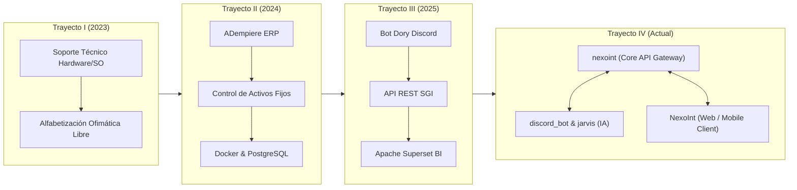

<p align="center">
  <a href="https://github.com/jesusalbujas/control-pst">
    
  </a>
</p>

<h1 align="center">Control PST & Ecosistema de Servicios Tecnológicos</h1>

<p align="center">
  <strong>Universidad Politécnica Territorial del Estado Portuguesa "Juan de Jesús Montilla" (UPTEP JJ Montilla)</strong><br>
  <em>Programa Nacional de Formación en Informática (PNFI) — Acarigua, Portuguesa, Venezuela</em>
</p>

<p align="center">
  
  
  
  
  
  
  
</p>

---

## 📖 Descripción General

**Control PST** es el repositorio central que consolida la infraestructura técnica, el despliegue de microservicios contenerizados y la memoria histórica de los **Proyectos Socio Tecnológicos (PST I, II, III y IV)** desarrollados a lo largo del Programa Nacional de Formación en Informática (PNFI).

El proyecto integra soluciones de gestión empresarial (ERP), automatización con bots de soporte interactivo, analítica de datos en tiempo real y la nueva arquitectura modular orientada a microservicios e inteligencia aplicada (`nexoint`, `discord_bot`/`jarvis` y `NexoInt`).

---

## 📚 Centro de Documentación y Memoria de Proyectos (PST)

Toda la documentación técnica, esquemas normativos del PNFI y desgloses por trayecto se encuentran organizados y centralizados:

| Documento | Enlace | Descripción |
| :--- | :---: | :--- |
| 📑 **Índice General de Documentación** | [**Ver Índice**](./docs/README.md) | Portal maestro con línea de tiempo, enlaces y recursos. |
| 📋 **Esquemas PST 2018 (Markdown)** | [**Ver Esquema**](./docs/esquemas-pst-2018.md) | Transcripción íntegra del esquema oficial 2018 para Trayectos I al IV. |
| 📄 **Esquemas PST 2018 (PDF Original)** | [**Descargar PDF**](./docs/ESQUEMAS%20DE%20PST%202018.pdf) | Documento original emitido por la coordinación del PNFI. |
| 🏫 **Trayecto I (PST I)** | [**Ver Proyecto**](./docs/proyectos/pst-1.md) | Alfabetización y soporte técnico en Software Libre (U.E.C. Fe y Alegría). |
| 🏢 **Trayecto II (PST II)** | [**Ver Proyecto**](./docs/proyectos/pst-2.md) | Implementación de módulo de Activos Fijos en ADempiere ERP (ERP Consultores C.A.). |
| 🌐 **Trayecto III (PST III)** | [**Ver Proyecto**](./docs/proyectos/pst-3.md) | Sistema Web de Servicios, Bot Dory (Discord) y Superset BI (ERP Consultores C.A.). |
| 🚀 **Trayecto IV (PST IV - Actual)** | [**Ver Arquitectura**](./docs/proyectos/pst-4-arquitectura.md) | Nueva arquitectura: `nexoint` (API Core), `discord_bot` (`jarvis`) y `NexoInt`. |
| 🧭 **Guía técnica de procesos PST IV** | [**Ver Guía y referencias**](./docs/proyectos/pst-4-guia-tecnica-procesos.md) · [**Índice de referencias internas**](./docs/proyectos/referencias-tecnicas/README.md) | Flujos de casos, API de conversaciones, releases de Jarvis, IA y consola NexoKube; documentación disponible dentro de este repositorio. |
| 🗄️ **Modelo de Base de Datos Relacional** | [**Ver Modelo de BD**](./docs/database/README.md) | Esquema `dory` en Supabase (PostgreSQL 16), diagramas ER, RBAC y diccionario. |

---

## 📅 Plan de Ejecución del Informe PST IV

Para consultar la planificación de trabajo y distribución de tareas del equipo para la entrega del informe final, consulte:

👉 **[Ver Plan de Trabajo y Cronograma de Ejecución (PST IV)](./docs/proyectos/pst-4-plan-de-trabajo.md)**

---

## 🏛️ Evolución de la Arquitectura



---

## 📂 Estructura del Repositorio

```
control-pst/
├── customization/               <- Personalizaciones, scripts Groovy, SQL y validaciones ADempiere
│   ├── process/                 <- Procesos de negocio (Asignación, Devolución, Ubicación)
│   ├── sql/                     <- Triggers y estructuras de tablas custom
│   ├── validations/             <- Reglas de validación en tiempo de ejecución
│   └── report/                  <- Reportes maestros y transaccionales
├── deployment/                  <- Recetas de despliegue contenerizado (Docker Compose)
│   ├── docker-compose.yml       <- Orquestación principal ADempiere ERP y PostgreSQL
│   ├── keycloak/                <- Proveedor de identidad y SSO para ADempiere
│   ├── dory-keycloak/           <- Configuración Keycloak y temas para Bot Dory
│   ├── dory_app/                <- Despliegue de aplicación web y proxy Nginx
│   ├── superset/                <- Plataforma de Business Intelligence (Apache Superset)
│   └── postgresql/              <- Scripts de inicialización y backups de base de datos
├── docs/                        <- Documentación técnica centralizada
│   ├── README.md                <- Índice maestro de documentación
│   ├── esquemas-pst-2018.md     <- Esquema oficial PNFI en formato Markdown
│   ├── ESQUEMAS DE PST 2018.pdf <- Documento PDF original
│   ├── diagrams/                <- Diagramas de arquitectura y workflows
│   └── proyectos/               <- Documentación detallada de PST I, II, III y IV
├── tools/                       <- Scripts de automatización y herramientas de utilidad
│   ├── install_tools.sh         <- Instalador automatizado de Docker, Compose y Git
│   ├── backup.sh                <- Script de respaldo de bases de datos
│   └── estructura.sql / .dbml   <- Modelado y esquema relacional de datos
└── README.md                    <- Presentación y guía principal del repositorio
```

---

## ⚡ Guía de Inicio Rápido (Quickstart)

### 1. Requisitos Previos
- Sistema Operativo: Linux (Ubuntu 22.04+ / Debian 12+ recomendado) o WSL2.
- Git y Docker Engine con plugin Docker Compose v2.

### 2. Instalación Automatizada de Dependencias

Si aún no cuenta con Docker o Git en su equipo, ejecute el script automatizado incluido en el directorio `tools/`:

```bash
chmod +x tools/install_tools.sh
./tools/install_tools.sh
```

### 3. Configuración de Host y Dominio Local

Agregue la resolución de dominios locales en su archivo `/etc/hosts`:

```bash
sudo nano /etc/hosts
```

Agregue las siguientes entradas:
```text
127.0.0.1       localhost
127.0.0.1       adempiere
127.0.0.1       api.adempiere.io
```

### 4. Despliegue del Entorno con Docker Compose

Acceda al directorio `deployment/` y levante los servicios:

```bash
cd deployment

# Levantar contenedores en segundo plano
docker compose up -d
```

### 5. Servicios Disponibles y Puertos

| Servicio | URL / Puerto | Descripción |
| :--- | :---: | :--- |
| **ADempiere Web ZK** | `http://localhost:8080` / `http://api.adempiere.io` | Interfaz Web de Gestión ERP |
| **Base de Datos PostgreSQL** | `localhost:5436` | Instancia de base de datos relacional (User: `adempiere`) |
| **Keycloak SSO Auth** | `http://localhost:3333` | Servidor de Identidad y Autenticación Centralizada |
| **Apache Superset BI** | `http://localhost:8088` | Tableros de analítica y métricas de soporte (`deployment/superset`) |

---

## 👥 Equipo de Autores y Créditos

- **Jesús Albujas** ([@jesusalbujas](https://github.com/jesusalbujas))
- **Jesús Hernández**
- **Daniel Pérez**
- **José Zúñiga**
- **Giovana Garrido**
- **Albany Reyes**
- **Candy Gutiérrez**
- **Cristian Camacho**

**Institución:** Universidad Politécnica Territorial del Estado Portuguesa "Juan de Jesús Montilla" (UPTEP JJ Montilla)  
**Comunidades Beneficiadas:** U.E.C. Fe y Alegría "Nuestra Señora de Coromoto" & ERP Consultores y Asociados C.A.
