# Proyecto Socio Tecnológico IV (Trayecto IV) - Nueva Arquitectura y Modelo de Negocio

> **Documento de Especificación Arquitectónica y Guía para el Informe de Proyecto Socio Tecnológico IV**  
> **Institución:** Universidad Politécnica Territorial del Estado Portuguesa "Juan de Jesús Montilla" (UPTEP JJ Montilla)  
> **Programa:** Programa Nacional de Formación en Informática (PNFI)  
> **Organización Beneficiaria:** ERP Consultores y Asociados C.A.  
> **Ecosistema Tecnológico:** NexoInt Web | Dory/Jarvis en Discord | Supabase | App móvil NexoInt (en desarrollo)
> **Referencia Metodológica:** [Esquemas de PST 2018 - Trayecto IV](../esquemas-pst-2018.md#4-proyecto-socio-tecnológico-iv-trayecto-iv)

---

## Tabla de Contenidos

- [Proyecto Socio Tecnológico IV (Trayecto IV) - Nueva Arquitectura y Modelo de Negocio](#proyecto-socio-tecnológico-iv-trayecto-iv---nueva-arquitectura-y-modelo-de-negocio)
  - [Tabla de Contenidos](#tabla-de-contenidos)
  - [1. Introducción y Visión General del Proyecto](#1-introducción-y-visión-general-del-proyecto)
  - [2. Fase I: Planificación, Diagnóstico y Modelo de Negocio](#2-fase-i-planificación-diagnóstico-y-modelo-de-negocio)
    - [2.1 Contexto y Diagnóstico Situacional Participativo](#21-contexto-y-diagnóstico-situacional-participativo)
    - [2.2 Modelo de Negocio de ERP Consultores y Asociados C.A.](#22-modelo-de-negocio-de-erp-consultores-y-asociados-ca)
    - [2.3 Mapa y Flujograma de Procesos de Negocio](#23-mapa-y-flujograma-de-procesos-de-negocio)
    - [2.4 Diagrama de Casos de Uso del Negocio (CUN)](#24-diagrama-de-casos-de-uso-del-negocio-cun)
    - [2.5 Matriz FODA y Árbol del Problema](#25-matriz-foda-y-árbol-del-problema)
  - [3. Fase II: Requerimientos, Diseño y Nueva Arquitectura de Software](#3-fase-ii-requerimientos-diseño-y-nueva-arquitectura-de-software)
    - [3.1 Visión Arquitectónica General](#31-visión-arquitectónica-general)
    - [3.2 Pilar 1: NexoInt Web](#32-pilar-1-nexoint-web-aplicación-administrativa)
    - [3.3 Pilar 2: `discord_bot` (Dory y Jarvis)](#33-pilar-2-discord_bot-y-jarvis-automatización-inteligente-y-soporte-cognitivo)
    - [3.4 Aplicación móvil NexoInt (En desarrollo)](#34-aplicación-móvil-nexoint-en-desarrollo)
    - [3.5 Diagrama de Interacción y Flujo de Datos Global](#35-diagrama-de-interacción-y-flujo-de-datos-global)
    - [3.6 Diagrama de Componentes y Despliegue](#36-diagrama-de-componentes-y-despliegue)
    - [3.7 Modelo de Datos Relacional y Esquema de Entidades](#37-modelo-de-datos-relacional-y-esquema-de-entidades)
  - [4. Fase III: Estrategias de Implantación, Pruebas y Auditoría Informática](#4-fase-iii-estrategias-de-implantación-pruebas-y-auditoría-informática)
    - [4.1 Plan de Pruebas Automatizadas y de Integración](#41-plan-de-pruebas-automatizadas-y-de-integración)
    - [4.2 Plan de Auditoría Informática y Seguridad](#42-plan-de-auditoría-informática-y-seguridad)
  - [5. Fase IV: Resultados, Diagrama de Red y Evaluación Integral de Riesgos](#5-fase-iv-resultados-diagrama-de-red-y-evaluación-integral-de-riesgos)
    - [5.1 Diagrama Físico y Lógico de la Red](#51-diagrama-físico-y-lógico-de-la-red)
    - [5.2 Matriz de Factores y Evaluación de Riesgos](#52-matriz-de-factores-y-evaluación-de-riesgos)
  - [6. Fase V: Estructura de Manuales y Políticas de Seguridad](#6-fase-v-estructura-de-manuales-y-políticas-de-seguridad)
  - [7. Guía de Redacción para el Equipo de Proyecto](#7-guía-de-redacción-para-el-equipo-de-proyecto)

---

## 1. Introducción y Visión General del Proyecto

El **Trayecto IV del Programa Nacional de Formación en Informática (PNFI)** representa la cúspide académica y técnica del perfil de Ingeniería en Informática. En este trayecto, el proyecto evoluciona desde sistemas aislados o de soporte básico hacia un **Ecosistema Digital Modular, Distribuido e Inteligente**, capaz de gestionar la totalidad de las operaciones de servicios tecnológicos de la empresa **ERP Consultores y Asociados C.A.**

El sistema vigente se organiza alrededor de la aplicación web NexoInt, el bot de Discord Dory/Jarvis y Supabase. La aplicación móvil y el acceso de compañías continúan en desarrollo. El código se revisó en los repositorios disponibles; la presencia de una función en el árbol de trabajo no confirma por sí sola que esté publicada en producción.

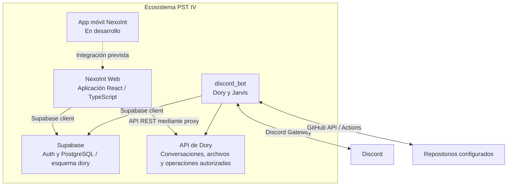

---

## 2. Fase I: Planificación, Diagnóstico y Modelo de Negocio

### 2.1 Contexto y Diagnóstico Situacional Participativo
- **Organización:** ERP Consultores y Asociados C.A.
- **Ámbito:** Consultoría tecnológica, parametrización de ERPs, soporte corporativo a sistemas empresariales y desarrollo de software a medida.
- **Diagnóstico Técnico-Operativo:** Tras los avances logrados en los trayectos anteriores (PST II: Activos Fijos y PST III: Sistema SGI / Bot Dory inicial), la empresa experimentó una expansión en su volumen de clientes. Esto evidenció la necesidad de:
  1. Centralizar la lógica transaccional y de autenticación en una plataforma unificada (`nexoint`).
  2. Integrar inteligencia y flujos automáticos más robustos mediante agentes inteligentes (`jarvis` y `discord_bot`).
  3. Proveer a los usuarios internos una aplicación web administrativa; la aplicación móvil y el acceso directo de compañías continúan en desarrollo.

### 2.2 Modelo de Negocio y Reglas Operativas de ERP Consultores y Asociados C.A.

Para este proyecto, el foco es organizar la atención de soporte y las solicitudes internas, mejorar su trazabilidad y automatizar tareas de operación y publicación de software. Los contratos, las bolsas de horas y la facturación no forman parte del alcance funcional acordado.

| Bloque del Modelo | Descripción Aplicada al Proyecto |
| :--- | :--- |
| **Propuesta de Valor** | Herramientas para centralizar casos, registrar su seguimiento, generar indicadores y apoyar la operación de consultores con automatización. |
| **Segmento de Clientes** | Empresas medianas y grandes que utilizan sistemas ERP (ADempiere, Odoo u homólogos) y requieren mantenimiento, consultoría y soporte especializado. |
| **Canales de Interacción** | • `discord_bot`: Atención y coordinación de casos en Discord. • NexoInt Web: administración, consultas, reportes y operación interna. • App móvil: en desarrollo, alcance por confirmar. • Jarvis: apoyo a documentación y automatización de releases. |
| **Relación con Clientes** | Atención coordinada por caso, con historial, asignación y reportes operativos. |
| **Fuentes de Ingresos** | La empresa puede prestar soporte, consultoría e implementación; la gestión de contratos, tarifas, bolsas y facturación no está incluida en las funciones de este proyecto. |
| **Actividades Clave** | Atención y seguimiento de casos, administración de la plataforma, análisis de indicadores y automatización de tareas de soporte y releases. |
| **Recursos Clave** | Infraestructura en la nube / contenedores Docker, bases de datos PostgreSQL en Supabase, APIs de comunicación, equipo humano de desarrollo y consultoría. |
| **Socios Clave** | Comunidades de Software Libre, proveedores de infraestructura cloud, proveedores de modelos de lenguaje / IA. |
| **Estructura de Costos** | Alojamiento en servidores, ancho de banda, licencias de APIs externas, nómina de consultores y costos operativos de mantenimiento. |

#### Reglas de Negocio Clave en el Ecosistema Operativo (Discord ↔ NexoInt ↔ Jarvis):

1. **Relación entre compañías, canales y Discord:** los registros de compañía y canal se vinculan con identificadores de Discord además de sus nombres. La incorporación de usuarios externos y el aislamiento por compañía siguen en desarrollo; no se debe asumir que el portal de cliente ya está terminado.

2. **Creación y sincronización de casos:** los casos se originan en Discord y se sincronizan con NexoInt. La asociación de compañía y canal debe validarse antes de confirmar la creación; NexoInt permite gestionar los registros existentes de acuerdo con los permisos asignados.

3. **Integridad Categorial Estricta (`validateCategoryMatch`):**
   - Un ticket (`dory_thread`) **jamás puede pertenecer a un canal cuya categoría en base de datos difiera del cliente asignado**.
   - Si un usuario o proceso intenta vincular un ticket con una empresa cliente A y un canal perteneciente a la empresa cliente B, el sistema detiene la transacción y emite una excepción de coherencia referencial (`ThreadEntity`).

4. **Acciones destructivas sobre casos:** deben estar protegidas por permisos y confirmación; si se elimina un caso enlazado, el flujo debe informar y coordinar el cambio con Discord. La auditoría debe permitir identificar el resultado de la operación.

5. **Responsabilidad y asignación:** un mensaje de una persona en el hilo no debe asignar automáticamente el caso a esa persona. La asignación se gestiona mediante las acciones previstas para consultores y administradores; los estados de atención y `Pendiente por` se mantienen separados del estado abierto/cerrado.

6. **Seguimientos de Dory:** los recordatorios deben considerar el historial del hilo, a quién le corresponde responder, el calendario laboral y los festivos configurados. La hora local, la frecuencia y la prevención de duplicados deben verificarse en ejecución; no se documentan como garantías sin esa comprobación.

7. **Tiempo consumido:** se pueden registrar horas y minutos asociados a un caso como dato operativo. Esto no implica descontar saldo contractual ni emitir recibos; esos procesos están fuera del alcance actual.

8. **Supervisión humana en publicaciones (`Jarvis`):**
   - Los borradores de notas de versión y documentación técnica sugeridos por IA (`dory_jarvis_release_run`) no pueden emitirse como oficiales ni generar artefactos PDF sin la aprobación y cambio explícito de estado por parte de un ingeniero responsable.

### 2.3 Mapa y Flujograma de Procesos de Negocio

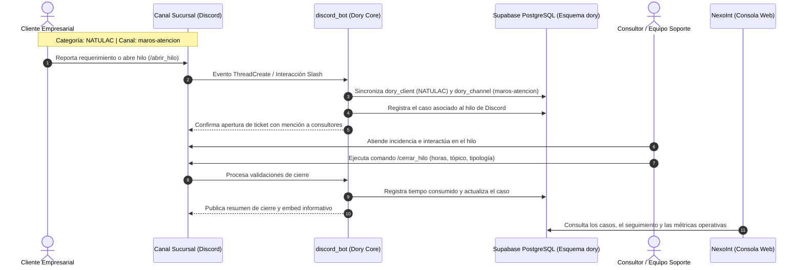

### 2.4 Diagrama de Casos de Uso del Negocio (CUN)

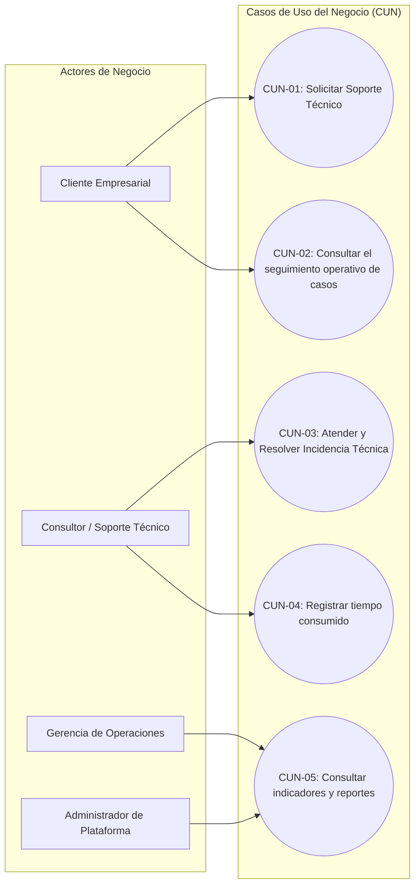

### 2.5 Matriz FODA y Árbol del Problema

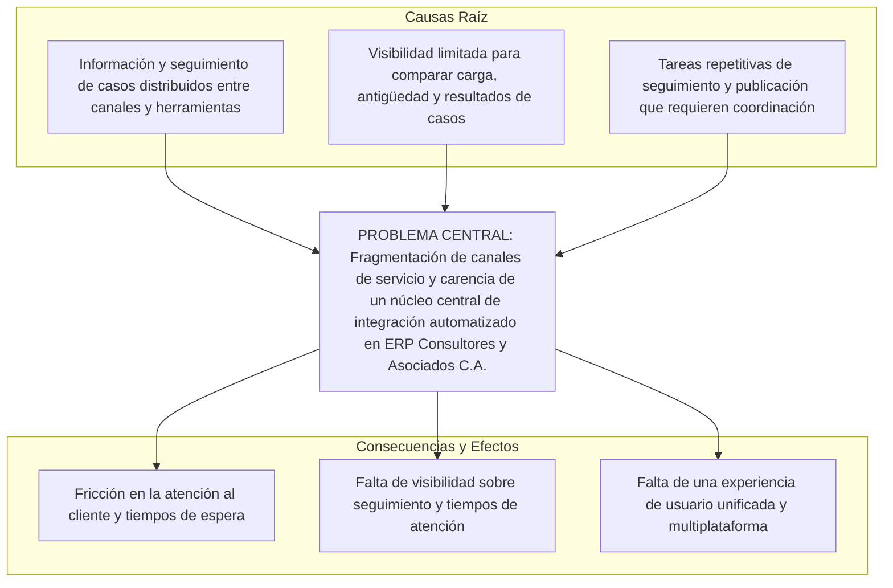

---

## 3. Fase II: Requerimientos, Diseño y Nueva Arquitectura de Software

### 3.1 Visión Arquitectónica General

La arquitectura que se observa en los repositorios es una aplicación web SPA, una base administrada en Supabase y un bot/API de Discord. No se encontró un backend propio de NexoInt organizado como microservicios ni un Redis del proyecto; por ello, el diagrama refleja las integraciones presentes y no propone esos componentes como implementados.

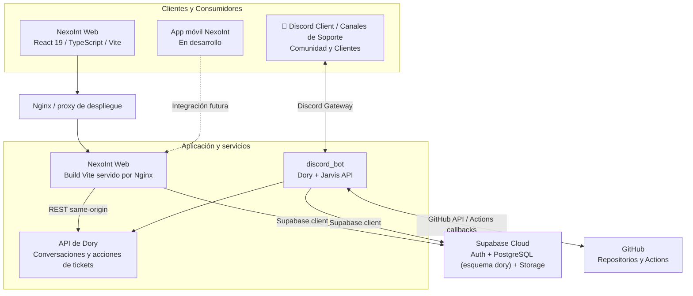

---

### 3.2 Pilar 1: NexoInt Web (aplicación administrativa)

El repositorio `nexoint` contiene una aplicación web SPA construida con React, TypeScript, Vite y Tailwind CSS. Se sirve como contenido estático detrás de Nginx y consume Supabase Auth/PostgREST y la API de Dory para las operaciones que requieren acceso a Discord. No equivale a un backend propio ni a un API Gateway; los permisos de interfaz deben complementarse con las políticas de base de datos y los controles de cada API.

#### 3.2.1 Arquitectura de Autenticación y Logins Externos
NexoInt integra un sistema de identidad federada multi-proveedor gestionado a través de Supabase Auth:
1. **Proveedores OAuth configurados:** inicio de sesión federado a través de Supabase Auth. Los dominios, redirect URIs y proveedores efectivos se deben documentar desde la configuración del ambiente.
2. **Vínculo con Discord:** la identidad de Discord puede asociarse al usuario/empleado para resolver menciones y asignaciones; no asumir que iniciar sesión por Discord completa automáticamente todos los vínculos de perfil.
3. **Credenciales clásicas:** inicio de sesión por correo y contraseña, recuperación y flujos de cambio de contraseña gestionados por Supabase Auth.

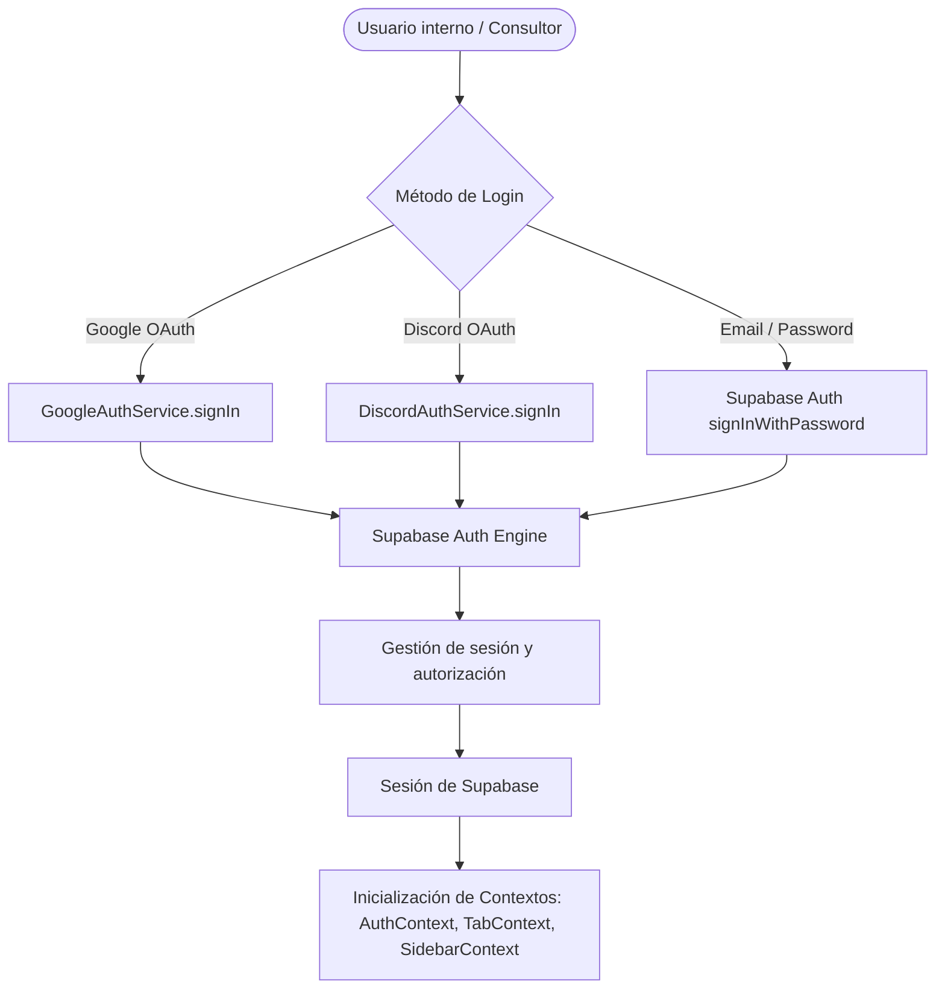

#### 3.2.2 Lógicas de Seguridad Avanzada y Gestión de Sesión (`SessionSecurityService`)
La aplicación gestiona la sesión de Supabase y contempla renovación, expiración por inactividad, cierre de sesión y validación al restaurar la aplicación. La duración efectiva depende de la configuración de Supabase y de la implementación desplegada; no se atribuyen certificaciones NIST/OWASP ni límites temporales que no estén verificados.

#### 3.2.3 Control de Acceso Basado en Roles (RBAC Dinámico)
El sistema aplica una matriz de permisos por rol y ventana; las reglas de UI y las políticas de datos deben mantenerse alineadas:
- **Catálogo de Ventanas (`dory.dory_window`):** Cada módulo de la aplicación posee un identificador único (*slug*).
- **Matriz de Permisos (`dory.dory_role_permissions`):** Asignación por rol de permisos booleanos independientes:
  - `can_read`: Lectura / Visualización.
  - `can_write`: Creación y Actualización.
  - `can_delete`: Eliminación física o lógica.
  - `can_export`: Descarga de reportes en Excel / PDF.
  - `only_own_records`: Restricción a registros propios cuando esa opción está habilitada para la ventana.

#### 3.2.4 Módulos Operativos y Estado de Implementación en NexoInt

El estado distingue la base funcional observada del alcance de continuidad descrito en la propuesta de octubre de 2026. Que exista una pantalla o una función parcial no significa que el entregable propuesto esté terminado. La propuesta define trabajo por ciclos y prioridades; cada ampliación permanece en desarrollo hasta que se complete y valide.

| Área | Base disponible | Estado del alcance de continuidad de octubre de 2026 |
|---|---|---|
| **Calendario y guardias** | Hay elementos de calendario en la aplicación. | **En desarrollo; RF-06 no está listo.** Completar y validar actividades, guardias, feriados, cumpleaños, permisos e impresión. |
| **Tickets y solicitudes internas** | NexoInt diferencia ambos tipos de caso y ofrece vistas/filtros. | **En desarrollo.** Consolidar campos, búsquedas, vistas y reportes para evitar mezclar ambos flujos e indicadores. |
| **Panel mensual de soporte** | Hay indicadores, filtros y detalle de casos. | **En desarrollo continuo.** Completar la ampliación por período y criterios de análisis establecidos en la propuesta. |
| **Reportes e impresión** | Existen formatos y exportación/impresión. | **En desarrollo.** Alinear resultados de pantalla, CSV/XLS/XLSX y PDF, conservar filtros y enlaces de navegación. |
| **Dory: seguimiento y cierre** | El bot gestiona seguimientos y flujos de cierre. | **En desarrollo.** Mejorar contexto, identificación de la próxima acción, confirmaciones y prevención de mensajes repetidos o improcedentes. |
| **Catálogos y políticas de atención** | NexoInt dispone de catálogos que consume el bot. | **En desarrollo.** Consolidar su administración y validar que Dory use los valores vigentes sin alterar decisiones asignadas al equipo. |
| **Conversaciones y adjuntos** | La API permite consultar conversación de Discord. | **En desarrollo.** Completar y validar autores, fechas, respuestas, reacciones, embeds, adjuntos, rangos y exportación, sin duplicar el historial en la base de datos. |
| **Tokens e integraciones** | Hay gestión de tokens y permisos por rol/ventana. | **En desarrollo.** Completar permisos diferenciados de lectura, exportación y escritura y verificar autorización en cada endpoint. |
| **Jarvis: releases** | Hay automatización y generación de notas de releases. | **En desarrollo.** Mejorar trazabilidad entre ZK, Swing, Patch y bibliotecas; redactar notas funcionales sin duplicados y hacer recuperables las publicaciones fallidas. |
| **NexoKube** | Existe una consola web para consultar recursos Kubernetes. | **En desarrollo activo.** Validar clústeres y recursos disponibles, salud, logs y acciones mutables bajo permisos explícitos por rol. |
| **Acceso de compañías** | Existen grupos y registros de compañías/canales para uso interno. | **En desarrollo.** Construir ingreso de usuarios externos, asignación de acceso y aislamiento verificable por compañía y sucursal. |
| **Aplicación móvil** | No se confirmó una aplicación móvil terminada en el material revisado. | **En desarrollo.** No atribuirle pantallas ni capacidades no confirmadas por el equipo. |
| **Calidad, seguridad y rendimiento** | Se realizan correcciones y ajustes durante la evolución del sistema. | **Trabajo continuo/en desarrollo.** Reproducir y corregir errores; revisar consultas, rendimiento, reintentos, idempotencia, seguridad y observabilidad, documentando evidencia de validación. |

La propuesta es una fuente de alcance, no evidencia de que una entrega ya se haya completado. Por eso, las capacidades base se describen como existentes y sus ampliaciones como trabajo en desarrollo, sin etiquetar el paquete completo como «implementado».

**Fuera del alcance actual:** gestión de contratos de servicio, bolsas de horas, recibos/facturación y dispositivos de marcaje. El registro de tiempo consumido por caso se conserva como dato operativo, sin asociarlo a débitos contractuales.

---

### 3.3 Pilar 2: `discord_bot` (Dory) y `jarvis` (Separación de Responsabilidades: Soporte vs. Releases)

Este pilar está compuesto por dos subsistemas claramente diferenciados por su ámbito de acción y propósito operativo:

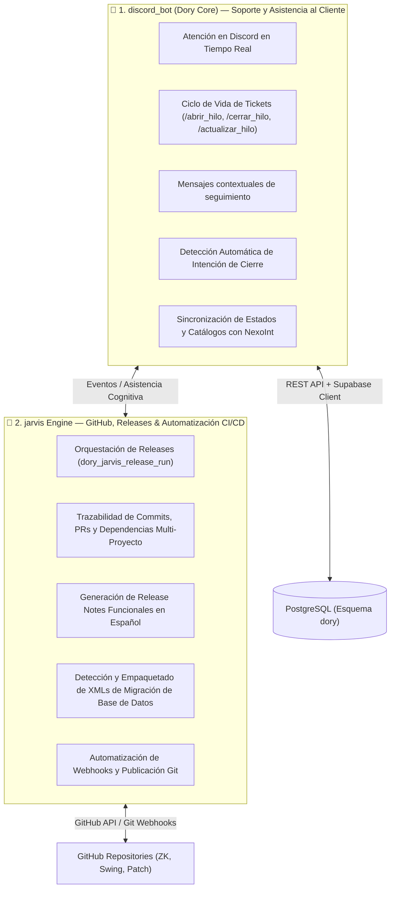

#### 3.3.1 `jarvis`: Orquestador de Releases, GitHub y Automatización CI/CD
`jarvis` es el motor técnico especializado en el ciclo de vida del software, repositorios de GitHub y publicaciones:
- **Generación Automatizada de Notas de Versión (*Release Notes*):** Orquestación de releases de software (`dory_jarvis_release_run`) analizando commits y PRs con plantillas estructuradas de prompt para repositorios Swing y ZK, explicando beneficios funcionales en español y detectando scripts XML de migración aplicables sin duplicar metadatos internos.
- **Trazabilidad de Cambios entre Proyectos:** Análisis secuencial de dependencias (ZK, Swing, Patch y bibliotecas ERP) para reflejar los cambios heredados efectivos entregados al cliente, incluso cuando se publican entre dos versiones del proyecto principal.
- **Automatización y Recuperación de Publicaciones:** Gestión y propagación de releases entre repositorios de GitHub, control de pre-releases, reporte de resultados de builds y capacidad de reintentar pasos fallidos sin duplicar entregas.

#### 3.3.2 `discord_bot` (Dory): Soporte y Gestión de Casos
`Dory` es el bot interactivo que opera directamente en los canales y servidores de Discord atendiendo a clientes y consultores:
- **Seguimientos asistidos por IA:** existen componentes para seleccionar contexto y redactar mensajes contextuales de seguimiento (a veces llamados *nudges*); su pertinencia, horario y tratamiento de frases de cierre continúan en afinación.
- **Detección de intención de cierre:** lógica separada del monitor de inactividad; la decisión final debe respetar el estado del caso y las reglas operativas.
- **Estados configurables:** el bot consume catálogos de atención y políticas; los estados de abierto/cerrado, atención y `Pendiente por` no deben confundirse.
- **Solicitudes internas:** se identifican por separado y se consideran de manera diferenciada en seguimientos e indicadores.

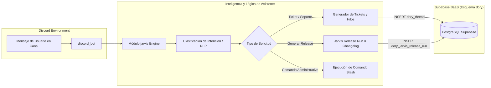

---

#### 3.3.4 Referencia al Modelo de Datos `dory`

> [!IMPORTANT]
> El inventario del esquema y sus diagramas se encuentran en:
> 🔗 [**Documentación del Modelo de Base de Datos NexoInt (Esquema `dory`)**](../database/README.md)

#### 3.3.2 Operación de casos en `discord_bot`

El bot mantiene comandos y eventos para abrir, actualizar, sincronizar, auditar y cerrar hilos; asignar consultores; y publicar respuestas o archivos en Discord. La apertura valida la resolución de compañía y canal antes de confirmar el registro. Las solicitudes internas se identifican separadamente para que puedan filtrarse en pantallas, reportes y reglas de seguimiento.

El estado de abierto/cerrado, el estado de atención y el valor de `Pendiente por` son conceptos distintos. El cierre registra el resultado de la atención y el tiempo consumido, sin facturar ni descontar contratos. Para evitar desincronización, la sincronización debe conservar la fecha real de creación del hilo y no sobrescribir un registro ya existente de forma inadvertida.

La API de Dory permite consultar conversaciones y adjuntos directamente desde Discord y admite publicar contenido autorizado. El proceso, los controles y las consideraciones de privacidad se describen en la [referencia interna de la API de conversaciones](./referencias-tecnicas/api-dory-conversaciones.md); las rutas y parámetros exactos se verifican contra la versión desplegada, porque pueden cambiar.

#### 3.3.3 Integridad y confiabilidad de las operaciones

- Validar compañía, canal e identificadores de Discord antes de confirmar una apertura o sincronización.
- Hacer idempotentes los reintentos y reportar resultado/error sin duplicar registros ni avisos.
- En comandos de Discord, responder o diferir la interacción dentro de su plazo; si expiró, registrar el fallo sin intentar una segunda respuesta.
- Generar mensajes contextuales de seguimiento con destinatario y horario local correctos. La detección de intención de cierre y la generación de estos recordatorios son responsabilidades distintas y deben permanecer separadas.
- Confirmar el comportamiento de días hábiles, festivos y recordatorios con el código desplegado; no asumir que todos los monitores aplican idéntico horario.

---

### 3.4 Aplicación móvil NexoInt (En desarrollo)

La aplicación móvil se mantiene como una línea de trabajo en desarrollo. No se encontró su código en los repositorios `nexoint` web ni `discord_bot` revisados en esta actualización. Por tanto, aquí se registra únicamente su estado; pantallas, plataformas objetivo, funciones y fecha de entrega deben completarse con evidencia del equipo móvil antes de presentarse como requisitos confirmados.

---

### 3.5 Diagrama de Interacción y Flujo de Datos Global

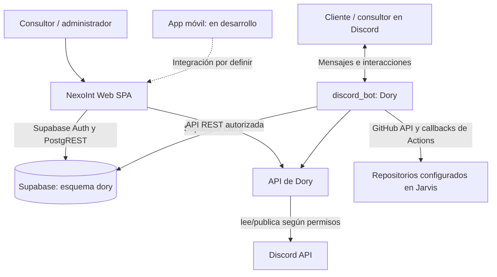

---

### 3.6 Diagrama de Componentes y Despliegue de Infraestructura

El código revisado contempla una imagen estática de NexoInt servida por Nginx y el servicio Node.js de `discord_bot`, que reúne Dory/Jarvis y sus endpoints. Supabase, Discord y GitHub son servicios externos. Los nombres de red, dominios, variables y topología de cada ambiente se documentan en los archivos de despliegue; este diagrama es lógico y no afirma que los componentes estén en una misma red o VPS.

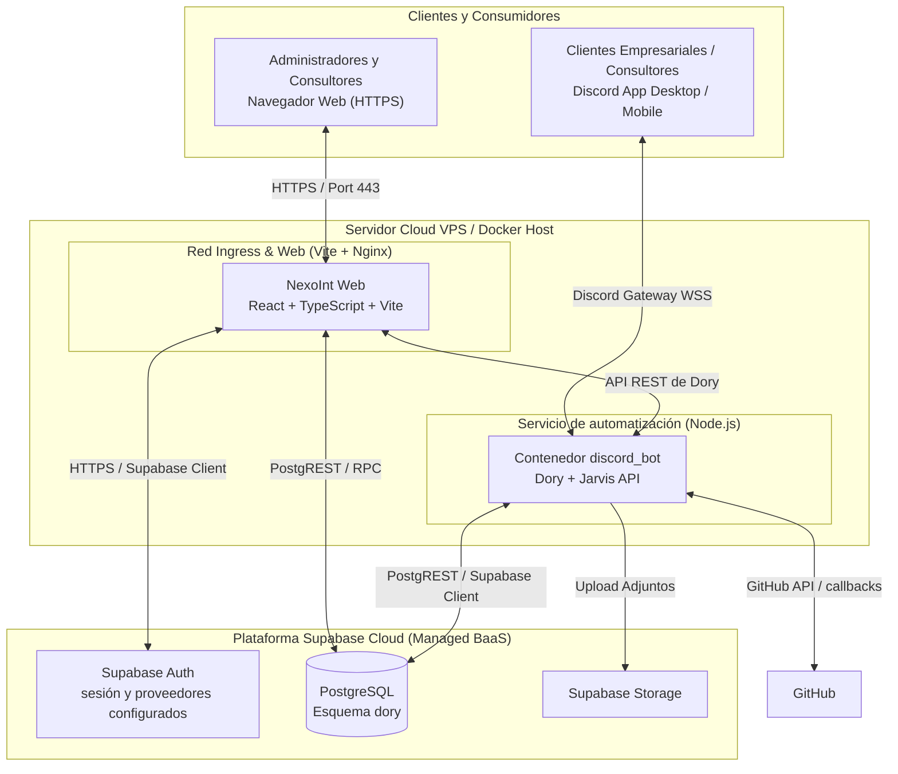

---

### 3.7 Modelo de Datos Relacional y Esquema de Entidades (Esquema `dory`)

El siguiente diagrama es una vista conceptual de relaciones principales identificadas en el código y el inventario de datos. No sustituye al esquema desplegado ni al diccionario vigente. Se excluyen aquí las tablas comerciales heredadas, que están fuera del alcance funcional actual.

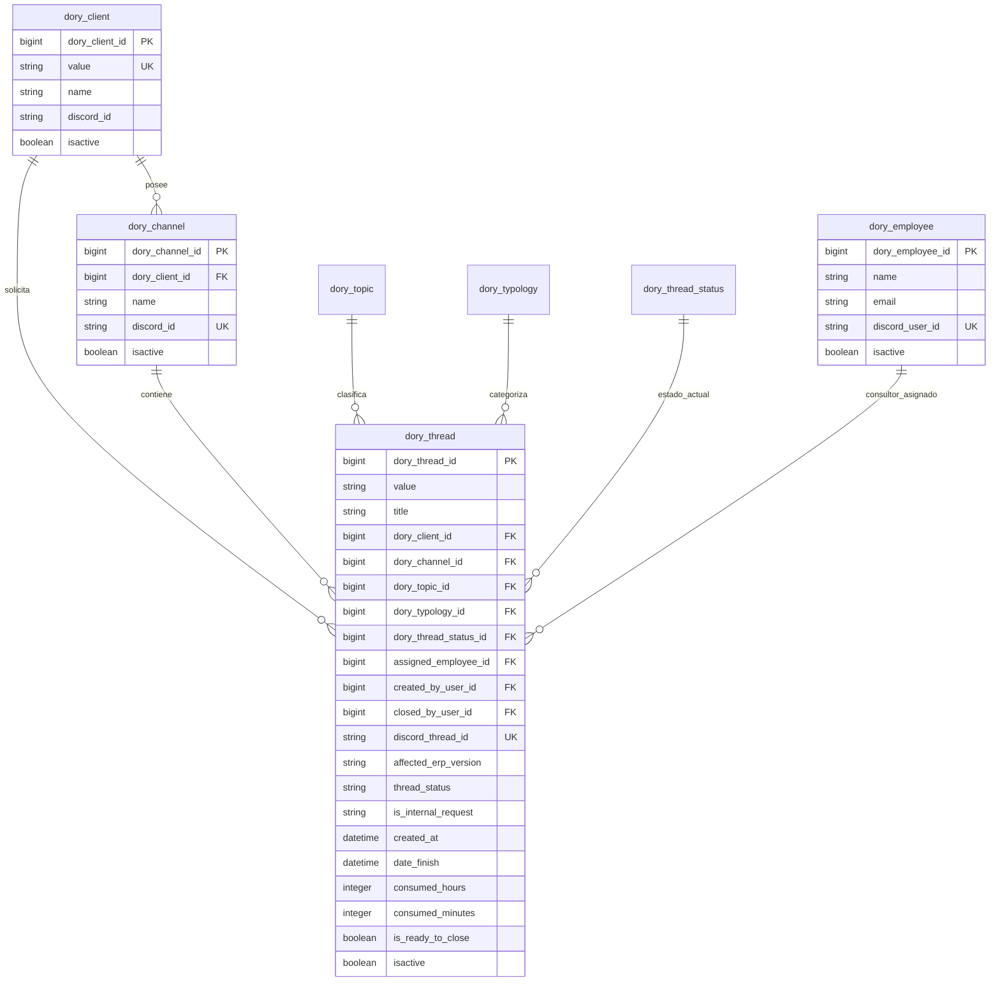

---

## 4. Fase III: Estrategias de Implantación, Pruebas y Auditoría Informática

### 4.1 Plan de Pruebas Automatizadas y de Integración

| Nivel de Prueba | Alcance y Herramientas | Criterio de Éxito |
| :--- | :--- | :--- |
| **Pruebas funcionales** | Casos reproducibles para autenticación, permisos, alta/sincronización/cierre de casos, calendario, reportes y releases. | Resultado observado y evidencia registrados por escenario. |
| **Pruebas de integración** | Flujo Discord → `discord_bot`/API de Dory → Supabase → visualización en NexoInt Web. | Estados, vínculos y permisos consistentes en los escenarios acordados. |
| **Pruebas de rendimiento** | Medición de operaciones críticas con un volumen de carga acordado antes de ejecutar. | Reportar medidas reales; no fijar umbrales sin aprobación y línea base. |
| **Pruebas de Aceptación (UAT)** | Validación directa con el personal de ERP Consultores y Asociados C.A. y clientes de prueba. | Firma de conformidad y usabilidad satisfactoria. |

### 4.2 Plan de Auditoría Informática y Seguridad
De acuerdo con el esquema PST IV 2018, se debe incluir un **Informe de Resultados de Auditoría Informática**:
1. **Revisión de seguridad:** definir herramientas y alcance antes del análisis; registrar hallazgos reproducibles, severidad y correcciones. No declarar auditorías SAST/DAST ejecutadas sin evidencia.
2. **Control de acceso:** comprobar roles, permisos de ventana/acción, RLS y alcance de tokens en la configuración desplegada, incluidos intentos permitidos y denegados.
3. **Respaldo y continuidad:** documentar la política realmente configurada por Supabase y los servicios de despliegue. Acordar y medir RPO/RTO antes de incluir objetivos numéricos.

---

## 5. Fase IV: Resultados, Diagrama de Red y Evaluación Integral de Riesgos

### 5.1 Diagrama Físico y Lógico de la Red

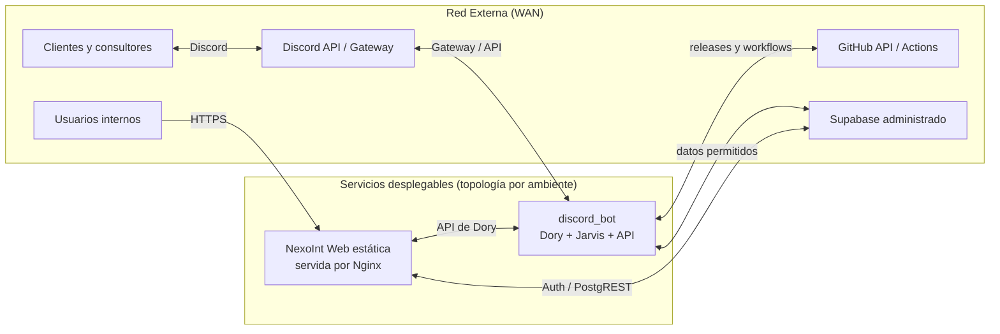

### 5.2 Matriz de Factores y Evaluación de Riesgos

| Factor de Riesgo | Tipo | Nivel | Estrategia de Mitigación / Plan de Contingencia |
| :--- | :--- | :---: | :--- |
| **Interrupción de Discord o de la API de Dory** | Tecnológico / Externo | Por evaluar | Mostrar el fallo con claridad, preservar los datos confirmados y permitir reintentar sin duplicar operaciones cuando corresponda. |
| **Indisponibilidad de Supabase** | Tecnológico / Externo | Por evaluar | Identificar operaciones afectadas y validar la recuperación con las capacidades y el plan contratado del servicio. |
| **Acceso indebido entre compañías** | Seguridad / Privacidad | Por evaluar | Completar el modelo de acceso externo en desarrollo y verificar aislamiento en RLS/API antes de habilitar usuarios de compañías. |
| **Permisos desactualizados o excesivos** | Seguridad | Por evaluar | Revisar roles, privilegio mínimo, políticas de base de datos y controles del servidor; la interfaz no es una frontera de seguridad suficiente. |
| **Dependencia de integraciones externas** | Operativo | Por evaluar | Documentar disponibilidad, límites y credenciales de Discord, GitHub, Supabase y servicios de IA; revisar alertas y procedimiento de contingencia. |

---

## 6. Fase V: Estructura de Manuales y Políticas de Seguridad

De acuerdo con el esquema oficial de PST IV, el informe final debe incorporar:
1. **Manual de Usuario:** Guía ilustrada para consultores y administradores de NexoInt Web y para clientes/consultores que interactúan con Dory en Discord. No presentar el portal de compañías como disponible mientras siga en desarrollo.
2. **Manual de Sistemas:** Documentación técnica de arquitectura, endpoints disponibles de la API de Dory, variables de entorno sin secretos y diagramas del esquema contrastados con migraciones vigentes. No inventar microservicios ni endpoints Swagger/OpenAPI que no estén en el proyecto.
3. **Manual de Instalación:** Instrucciones paso a paso para desplegar el ecosistema mediante Docker Compose (`docker compose up -d`) y variables de entorno `.env`.
4. **Manual de Normas y Procedimientos:** Procedimientos operativos para configuración de compañías/canales, atención y cierre de casos, guardias y releases, distinguiendo los flujos ya habilitados de los que siguen en desarrollo.
5. **Políticas y Estándares de Seguridad Informática:**
   - *Seguridad Física:* Control de acceso a servidores locales y terminales de trabajo.
   - *Seguridad Lógica:* Política de contraseñas robustas, rotación periódica de tokens y llaves API, y política de copias de seguridad redundantes.

---

## 7. Guía Metodológica y Asignación de Tareas para la Redacción del Informe

> [!IMPORTANT]
> **Propósito de esta Documentación:**  
> Este documento técnico, junto con el [Modelo de Base de Datos](../database/README.md) y los diagramas generados, constituye la **base de ingeniería y arquitectura** del proyecto. El objetivo es que los demás integrantes del equipo de proyecto tomen estos insumos como punto de partida y se encarguen de la **redacción académica, justificación teórica y desarrollo de los capítulos del informe final** exigido por la coordinación del PNFI.

### 7.1 Matriz de Tareas y Qué Debe Redactar el Equipo por Fase

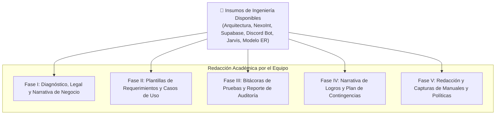

---

### 7.2 Detalle de Responsabilidades de Redacción

#### 📝 Fase I: Planificación del Proyecto y Diagnóstico Situacional
- **Qué tienen listo como base:** El modelo de negocio CANVAS, los actores clave, el árbol del problema y la matriz FODA estructurada en este documento.
- **Qué debe redactar el equipo:**
  1. *Antecedentes y Reseña Histórica:* Expandir la historia y organigrama de ERP Consultores y Asociados C.A.
  2. *Fundamentación Legal:* Redactar la justificación articulada con la **Constitución de la República Bolivariana de Venezuela (Art. 110)**, la **Ley de Infogobierno**, el **Plan de la Patria (Objetivos Históricos y Nacionales)** y el **Decreto 3.390 sobre Software Libre**.
  3. *Factibilidad:* Redactar el análisis descriptivo de factibilidad social, económica, operativa y técnica.
  4. *Narrativa del Problema:* Convertir el árbol de problemas y la matriz FODA en párrafos narrativos fluidos y contextualizados.

---

#### 📝 Fase II: Requerimientos, Diseño y Desarrollo del Software
- **Qué tienen listo como base:** La arquitectura observada de NexoInt Web, `discord_bot` (Dory/Jarvis), Supabase y sus integraciones; además, el inventario de datos y los flujos identificados. La revisión no constituye auditoría certificada ni confirma configuración de producción.
- **Qué debe redactar el equipo:**
  1. *Plantillas de Requerimientos Funcionales y No Funcionales:* Llenar cada ficha oficial del PNFI (ID, Nombre, Descripción detallada, Prioridad, Actor) para tickets y solicitudes internas, seguridad, calendario, reportes, releases, NexoKube, integración de conversación y líneas en desarrollo. Excluir contratos, bolsas de horas, recibos/facturación y marcajes.
  2. *Plantillas de Casos de Uso del Software (CUS):* Elaborar casos para apertura/sincronización y actualización de casos, consulta de conversación, calendario, reportes, releases y administración de accesos. El registro de tiempo es operativo, no un débito contractual.
  3. *Justificación Metodológica:* Redactar la justificación del uso de la metodología **MeRinde** combinada con prácticas ágiles y el estándar de calidad **RECLAMO**.
  4. *Interfaces de Usuario:* Adjuntar capturas de pantalla de los formularios de `nexoint` y maquetas de `NexoInt` con sus descripciones funcionales.

---

#### 📝 Fase III: Implantación, Pruebas y Auditoría Informática
- **Qué tienen listo como base:** Una propuesta de escenarios funcionales y de integración; el equipo debe ejecutar las pruebas, guardar evidencia e informar resultados medidos. No se declara una suite automatizada en el código revisado.
- **Qué debe redactar el equipo:**
  1. *Casos de Prueba Detallados:* Llenar las tablas de casos de prueba con: Entrada de datos, Pasos de ejecución, Resultado esperado y Resultado obtenido (con capturas de pantalla de logs o respuestas de la API).
  2. *Informe de Auditoría Informática:* Redactar el informe formal de auditoría explicando las herramientas utilizadas (SAST, DAST, análisis de endpoints, revisión de base de datos) y emitiendo el dictamen y recomendaciones.
  3. *Análisis de Métricas:* Redactar la interpretación cualitativa y cuantitativa de las métricas de software obtenidas.

---

#### 📝 Fase IV: Resultados y Logros del Proyecto
- **Qué tienen listo como base:** Un diagrama lógico de componentes y una matriz inicial de riesgos, pendientes de validación contra cada ambiente desplegado.
- **Qué debe redactar el equipo:**
  1. *Descripción del Producto:* Redactar la memoria descriptiva final explicando cómo el ecosistema resuelve la problemática diagnosticada en la Fase I y mejora el desempeño de la empresa.
  2. *Plan de Contingencia de Riesgos:* Desarrollar los párrafos explicativos de cada factor de riesgo (financiero, técnico, ambiental, legal) y su protocolo de mitigación.

---

#### 📝 Fase V: Manuales y Normativas
- **Qué tienen listo como base:** El índice y estructura de contenidos requeridos por el esquema 2018.
- **Qué debe redactar el equipo:**
  1. *Manual de Usuario:* Redactar la guía ilustrada para interacción de clientes por Discord y operación interna en NexoInt Web. Señalar como pendiente el acceso de compañías y la aplicación móvil.
  2. *Manual de Sistemas:* Compilar endpoints existentes de Dory, variables de entorno (sin valores secretos) y diagramas de base validados.
  3. *Manual de Instalación:* Guía de despliegue paso a paso para desarrolladores (`pnpm install`, `.env`, conexión a Supabase y Docker Compose).
  4. *Manual de Normas y Procedimientos:* Protocolos operativos internos de soporte y atención.
  5. *Políticas de Seguridad Informática:* Documento formal con las políticas de contraseñas, control de accesos RBAC y respaldo de información.

---

### 7.3 Checklist de Verificación para la Entrega Final

Antes de la entrega del informe final a la coordinación del PNFI y tutores, el equipo debe verificar:

- [ ] ¿Todas las fases I a V siguen la estructura exacta del [Esquema PST 2018](../esquemas-pst-2018.md#4-proyecto-socio-tecnológico-iv-trayecto-iv)?
- [ ] ¿Se utilizaron las plantillas oficiales para los Requerimientos Funcionales y No Funcionales?
- [ ] ¿Las especificaciones de casos de uso tienen sus diagramas de secuencia/actividad asociados?
- [ ] ¿El modelo de base de datos coincide con el [Diccionario de Datos del Esquema `dory`](../database/README.md)?
- [ ] ¿Se incluyeron todas las reflexiones críticas al final de cada fase?
- [ ] ¿Los manuales de usuario, sistemas, instalación y seguridad cuentan con imágenes y texto explicativo claro?
