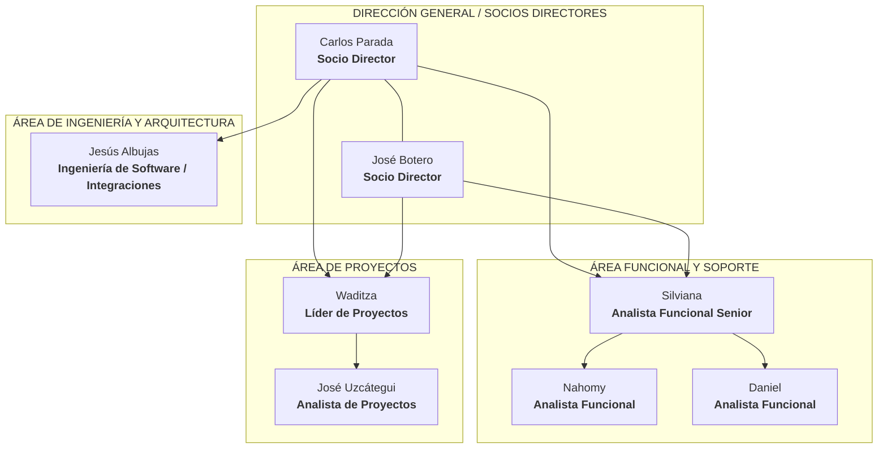

# 📋 Auditoría y Guía de Tareas — Fase I: Organigrama Empresarial y Modelo de Negocio
> **Asignación:** Albany Reyes (con apoyo directo a Jesús Hernández)  
> **Área:** Estructura Organizacional 2026, Plantillas de Casos de Uso del Negocio (CUN) y Diagramas  
> **Proyecto:** Proyecto Socio Tecnológico IV (PST IV) — PNFI / UPTEP "JJ Montilla"  
> **Fecha:** 28 de Octubre de 2026  

---

## 📌 Diagnóstico del Estado Actual en Google Docs

Tras la revisión técnica del documento de Google Docs (`Proyecto Socio-tecnológico IV`), se evidencia que la **Reseña Histórica, Misión, Visión y Fundamentación Legal** ya se encuentran redactadas. Sin embargo, existen dos puntos neurálgicos que requieren atención inmediata:

1. **La Imagen N° 2 (Organigrama Estructural):** Presenta inconsistencias graves en las líneas de mando y en la agrupación de cargos.
2. **La Sección III (Modelo del Negocio):** Las tablas de especificación de Casos de Uso del Negocio (CUN) están completamente en blanco y faltan los diagramas gráficos, por lo cual Albany debe incorporarse a apoyar a Jesús Hernández para completar esta sección hoy mismo.

---

## 1. ⚠️ Tarea Prioritaria 1: Corrección del Organigrama Estructural (Imagen N° 2)

### Problema Identificado en el Documento Actual:
- Se creó un bloque gigante denominado "Analistas Funcionales" donde se incluyó erróneamente a Jesús Albujas.
- Se colocó a Waditza dependiendo jerárquicamente de Jesús Albujas, lo cual es incorrecto.

### Estructura Jerárquica Real de ERP Consultores y Asociados C.A. (2026):
La organización opera mediante **tres ramas departamentales independientes** que reportan a la Dirección:

1. **Nivel Directivo (Cabecera):**
   - **Carlos Parada** (Socio Director).
   - **José Botero** (Socio Director).
2. **Rama 1: Consultoría Funcional y Soporte:**
   - **Silviana** (Analista Funcional Senior).
   - De Silviana se ramifican: **Nahomy** (Analista Funcional) y **Daniel** (Analista Funcional).
3. **Rama 2: Ingeniería de Software, Arquitectura y Automatización:**
   - **Jesús Albujas** (Ingeniería de Software / Integraciones). Depende directamente de Carlos Parada. Es un área técnica independiente del área funcional.
4. **Rama 3: Gestión de Proyectos:**
   - **Waditza** (Líder de Proyectos). Depende directamente de la Dirección General.
   - De Waditza depende: **José Uzcátegui** (Analista de Proyectos).
   *(El área de Proyectos es independiente: Waditza no depende de Jesús Albujas ni Jesús Albujas depende de Waditza).*

### Diagrama de Referencia para Graficar:

### Formato en el Documento:
- **Título arriba de la imagen:** `Imagen N° 2: Organigrama Estructural de ERP Consultores y Asociados C.A.`
- **Fuente abajo:** `Fuente: Reyes S. Albany A. (2026).`

---

## 2. ⚠️ Tarea Prioritaria 2: Apoyo a Jesús Hernández en el Modelo de Negocio (Sección III)

Actualmente, las siguientes tablas y diagramas están en blanco en el Google Docs y deben ser completados en equipo entre Albany Reyes y Jesús Hernández:

### A. Diseñar e Insertar el Diagrama de Casos de Uso del Negocio (CUN)
- **Ubicación en el Docs:** Párrafo 222 (actualmente no tiene imagen).
- **Contenido del Diagrama:** Debe mostrar los 4 actores del negocio y los casos de uso principales:
  - **Actores:** `Cliente Empresarial`, `Consultor de Soporte`, `Gerencia de Operaciones`, `Administrador de Plataforma`.
  - **Casos de Uso del Negocio:**
    1. *CUN-01: Solicitar Soporte Técnico.*
    2. *CUN-02: Consultar Seguimiento Operativo de Casos.*
    3. *CUN-03: Atender y Resolver Incidencia Técnica.*
    4. *CUN-04: Registrar Tiempo Consumido.*
    5. *CUN-05: Consultar Indicadores y Reportes de Actividad.*
  - 📖 *Diagrama listo para copiar:* Ver [Sección 2.4 de pst-4-arquitectura.md](./pst-4-arquitectura.md#24-diagrama-de-casos-de-uso-del-negocio-cun).

### B. Llenar las 4 Plantillas de Especificación CUN (Cuadros N° 11, 12, 13 y 14)
- **Ubicación en el Docs:** Tablas 6, 7, 8 y 9 (actualmente tienen el esqueleto pero todas las filas de texto están vacías).
- **Contenido a Vaciarse en Cada Cuadro:**
  1. **Cuadro N° 11 (CUN-01: Solicitar Soporte Técnico):**
     - *Actor:* Cliente Empresarial.
     - *Descripción:* El cliente reporta una solicitud o incidencia en el canal de Discord.
     - *Flujo Normal:* 1. El cliente accede a su canal de atención. 2. Escribe el requerimiento o ejecuta `/abrir_hilo`. 3. El sistema/bot registra la apertura.
  2. **Cuadro N° 12 (CUN-03: Atender y Resolver Incidencia):**
     - *Actor:* Consultor de Soporte.
     - *Descripción:* El consultor técnico diagnostica la causa, interactúa en el hilo de Discord y propone la solución técnica.
  3. **Cuadro N° 13 (CUN-04: Registrar Tiempo Consumido):**
     - *Actor:* Consultor de Soporte / Bot.
     - *Descripción:* Al resolver la incidencia, se ejecuta el comando de cierre registrando obligatoriamente el tópico, tipología y el tiempo invertido (horas y minutos).
  4. **Cuadro N° 14 (CUN-05: Consultar Indicadores y Reportes):**
     - *Actor:* Gerencia de Operaciones / Administrador.
     - *Descripción:* Visualización del panel web `NexoInt` para evaluar el cumplimiento de tiempos, carga de consultores y volumen de casos atendidos.

### C. Diseñar e Insertar el Diagrama de Actividad del Negocio
- **Ubicación en el Docs:** Párrafo 241 (actualmente no tiene imagen).
- **Contenido:** Flujo secuencial de carriles (*swimlanes*): Cliente (abre caso en Discord) ➔ Bot Dory (sincroniza caso en Supabase) ➔ Consultor (atiende y cierra con tiempo consumido) ➔ NexoInt (despliega métricas a gerencia).

---

## 3. ⚠️ Tarea Prioritaria 3: Depuración de Términos Desfasados en Procesos
- En el **Cuadro N° 3** y **Cuadro N° 5** (Párrafos 200 a 203):
  - Actualizar la fuente a **(2026)**.
  - Eliminar menciones a *"cierres de facturación formal"* y sustituir por *"auditoría y seguimiento de horas de servicio técnico"*.
