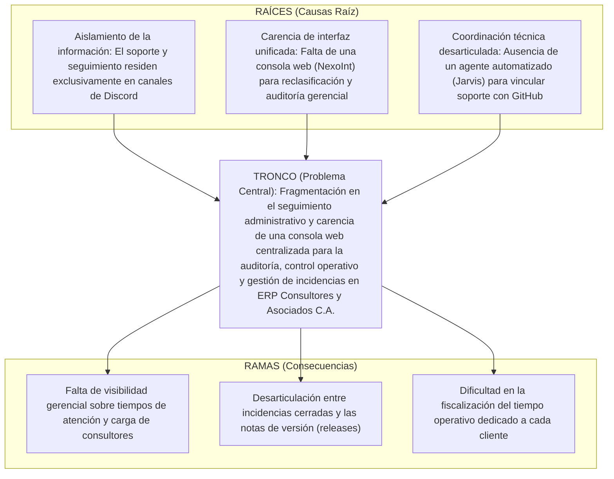

# 📋 Auditoría y Guía de Correcciones — Fase I: Diagnóstico Situacional y Viabilidad
> **Asignación:** Candy Gutiérrez  
> **Área:** Diagnóstico Situacional, Estudio de Factibilidad, Matriz FODA, Tabla de Jerarquización y Árbol del Problema  
> **Proyecto:** Proyecto Socio Tecnológico IV (PST IV) — PNFI / UPTEP "JJ Montilla"  
> **Fecha de Revisión:** 28 de Octubre de 2026  

---

## 📌 Resumen de Hallazgos en el Documento Actual (Google Docs)

Tras la revisión del documento oficial de Google Docs (`Proyecto Socio-tecnológico IV`), se identificaron avances importantes en la estructura, pero también inconsistencias metodológicas críticas que deben corregirse para cumplir con el esquema oficial PNFI 2018 y las directrices metodológicas del proyecto.

---

## 1. ⚠️ Factibilidad (Social, Económica, Técnica y Operativa)
- **Estado Actual en el Docs (Líneas 297 a 301):**  
  Los títulos de las 4 factibilidades fueron creados, pero **el contenido está completamente en blanco**:
  ```text
  FACTIBILIDAD (SOCIAL, ECONÓMICA, TÉCNICA Y OPERATIVA)
  A. Factibilidad Social
  B. Factibilidad Económica
  C. Factibilidad Técnica
  D. Factibilidad Operativa
  ```
- **Acción Requerida:** Redactar el contenido de cada una sustentado en el proyecto real de PST IV:
  - **A. Factibilidad Social:** Promoción de la soberanía tecnológica bajo la Ley de Infogobierno y Decreto N° 3.390; mejora en la calidad y tiempos de respuesta en el soporte a empresas nacionales atendidas por ERP Consultores y Asociados C.A.; vinculación activa UPTEP-sector productivo.
  - **B. Factibilidad Económica:** Cero costos por licenciamiento (100% Software Libre bajo licencias MIT/Apache); aprovechamiento de infraestructura Cloud escalable existente (Supabase y contenedores) sin requerir compras costosas de servidores dedicados; reducción de horas hombre perdidas en tareas de supervisión dispersa.
  - **C. Factibilidad Técnica:** Viabilidad plena mediante el uso de tecnologías modernas, estables y bien documentadas: Frontend en React 19/Vite/TypeScript (`NexoInt`), persistencia relacional administrada en PostgreSQL 16 (Supabase esquema `dory`), y automatizaciones mediante Discord Gateway API (`discord_bot`) y GitHub Actions (`Jarvis`). El equipo domina las herramientas.
  - **D. Factibilidad Operativa:** Adopción natural sin resistencia al cambio: los clientes continúan utilizando Discord (su canal habitual), mientras que los consultores y administradores disponen de una consola web intuitiva (`NexoInt`) que elimina la búsqueda manual entre hilos.
  - 📖 *Texto de referencia listo para usar:* Consultar la [Sección 4.A de pst-4-fase-1-guia-metodologica.md](./pst-4-fase-1-guia-metodologica.md#a-estudio-de-factibilidad-sección-actualmente-en-blanco-en-el-docs).

---

## 2. ⚠️ Delimitación de Alcance: Prohibición de Términos Contables / Facturación
- **Estado Actual en el Docs:**  
  En el párrafo introductorio, la Matriz FODA, la Tabla de Problemas y la Reflexión Crítica se repite constantemente:
  - *"para la contabilidad de horas facturables"*
  - *"proceder con la facturación formal"*
  - *"inexactitud contable y financiera"*
  - *"garantizando exactitud en la facturación"*
- **Riesgo Metodológico:**  
  **El alcance del sistema NO incluye módulos contables, tarifas, bolsas de horas comerciales ni facturación**. Si el informe promete "facturación y contabilidad", se exigirá la demostración de dichos módulos en la evaluación y entrega formal.
- **Acción Requerida:**  
  Reemplazar toda referencia a cobros/facturación por términos de **control operativo e ingeniería**:
  - Sustituir *"contabilidad de horas facturables / facturación formal"* por:  
    👉 **"Registro y trazabilidad de tiempo consumido / horas dedicadas al servicio técnico"**.
  - Sustituir *"inexactitud contable y financiera"* por:  
    👉 **"Dificultad en la fiscalización operativa y auditoría de la carga de trabajo de los consultores"**.

---

## 3. ⚠️ Árbol del Problema: Ajuste de Causas, Problema Central y Consecuencias
- **Estado Actual en el Docs (Imagen N°20 y esquema):**  
  Se describe el soporte como un proceso realizado *"a través de planillas de cálculo y mensajes, sin tecnología"*.
- **Riesgo Metodológico:**  
  En Trayecto III ya se aprobó el bot Dory en Discord y la base de datos de tickets. Afirmar que la empresa está *"sin tecnología"* contradice la aprobación de PST III y desvirtúa la madurez del proyecto en Trayecto IV.
- **Estructura Correcta para PST IV (2026):**



---

## 4. ⚠️ Matriz FODA y Tabla de Jerarquización de Problemas
- **Matriz FODA:**  
  - En **Debilidades:** Ajustar la mención de *"copiar a mano la información en tablas de cálculo"* por *"falta de sincronización entre los hilos de Discord y un panel de auditoría web"*.  
  - En **Oportunidades:** Cambiar *"control automático de horas cobrables"* por *"auditoría y medición precisa de tiempos de respuesta operativa"*.
- **Tabla de Jerarquización de Problemas:**  
  - Modificar el Problema N° 2 (actualmente: *"Transcripción manual hacia hojas de cálculo para la contabilidad de horas facturables"*).  
  - Redacción correcta: **"Dificultad para auditar y consolidar los tiempos operativos invertidos por el personal técnico en la atención de casos"** (Área afectada: Gestión de Operaciones y Soporte Técnico).

---

## 5. ⚠️ Diferenciación de Componentes (Dory vs. Jarvis)
- **Estado Actual:** En la Reflexión Crítica se menciona a *"Jarvis (Bot de Discord) para la captura de hilos"*.
- **Corrección Técnica:**  
  - El bot de Discord se llama **Dory** (`discord_bot`). Es quien interactúa con clientes, abre hilos y procesa comandos de cierre.  
  - **Jarvis** es el agente automatizado que apoya el flujo técnico de **GitHub** (documentación de issues y notas de versión). No mezclar ambos nombres en las descripciones de Discord.
