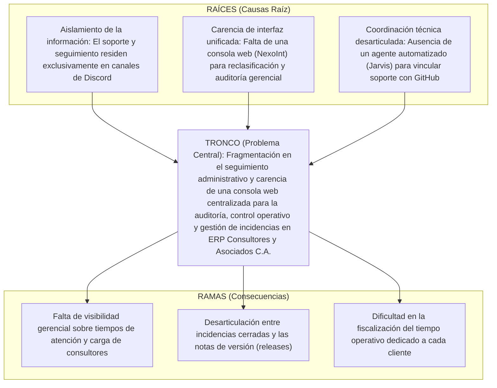

# 📋 Auditoría y Guía de Correcciones — Fase I: Diagnóstico Situacional y Viabilidad
> **Asignación:** Candy Gutiérrez  
> **Área:** Diagnóstico Situacional, Estudio de Factibilidad, Matriz FODA, Tabla de Jerarquización y Árbol del Problema  
> **Proyecto:** Proyecto Socio Tecnológico IV (PST IV) — PNFI / UPTEP "JJ Montilla"  
> **Última Revisión:** 30 de Octubre de 2026  

---

## 📌 Estado de Avance al 30 de Octubre de 2026

Tras la revisión detallada del documento `.docx` más reciente, se constata un avance fundamental:

1. **✅ Matriz FODA (Cuadro N° 15 / Tabla 10): APROBADA (10/10).**  
   Candy rehízo por completo la matriz FODA con un nivel técnico excelente:
   - **Cero menciones** a "hojas de cálculo", "Excel" ni "facturación".
   - Alineación total a PST IV: Sincronización Discord ↔ NexoInt ↔ Supabase, supervisión humana de IA (Jarvis), trazabilidad en horas y minutos, validación categórica y comandos `/abrir_hilo` y `/cerrar_hilo`.
   - Identificación honesta y precisa de debilidades y amenazas reales (componentes en desarrollo como móvil/externos, dependencia de APIs cloud y gestión de concurrencia).
2. **✅ Estudio de Factibilidad (Líneas 99 a 119): REDACTADO Y COMPLETADO.**  
   Las 4 perspectivas (Social, Económica, Técnica y Operativa) fueron desarrolladas en su totalidad. Solo requiere un ajuste menor de terminología en la parte Económica.
3. **⏳ Tareas pendientes para Candy:**  
   Ahora que la Matriz FODA está aprobada, Candy debe proceder con las **3 tareas restantes**:
   - Ajustar la **Tabla de Jerarquización de Problemas** (Problema N° 2).
   - Actualizar el **Árbol del Problema** (Texto e Imagen N° 20).
   - Actualizar la **Reflexión Crítica de la Fase I**.

---

## 1. ✅ Matriz FODA (Cuadro N° 15) — [COMPLETADA Y VALIDADA]
- **Evaluación:** La versión actual en la Tabla 10 del documento cumple al 100% con los requerimientos metodológicos y técnicos de Trayecto IV. Queda formalmente aprobada.

---

## 2. ⚠️ Estudio de Factibilidad: Ajuste Menor en Factibilidad Económica
- **Estado Actual:** Las secciones Social, Técnica y Operativa están impecables. En **Factibilidad Económica** (Párrafos 106-107) aún se colaron dos frases del modelo viejo:
  - *"procesos administrativos y de facturación"*
  - *"horas de soporte que anteriormente quedaban sin registrar o facturar"*
- **Ajuste Requerido:** Cambiar esas dos frases por:
  - 👉 *"procesos administrativos y de auditoría de servicio"*
  - 👉 *"horas de soporte que anteriormente quedaban sin trazabilidad operativa ni registro formal"*.

---

## 3. ⚠️ Tabla de Jerarquización de Problemas (Cuadro N° 16 / Tabla 11)
- **Estado Actual en el Docs:**  
  El Problema N° 2 sigue diciendo:
  > *"Transcripción manual y desestructurada de datos desde los chats hacia hojas de cálculo para la contabilidad de horas facturables."*
- **Ajuste Requerido:**  
  Reemplazar la redacción del Problema N° 2 por:  
  👉 **"Dificultad para auditar, fiscalizar y consolidar los tiempos operativos invertidos por el personal técnico en la atención de casos."**  
  (Área afectada: *Gestión de Operaciones y Soporte Técnico*).

---

## 4. ⚠️ Árbol del Problema (Párrafos 272-277 / Imagen N° 20)
- **Estado Actual en el Docs:**  
  El texto y la imagen siguen indicando que el soporte se realiza *"de manera manual a través de planillas de cálculo y mensajes, sin tecnología"*.
- **Ajuste Requerido:**  
  Actualizar el texto introductorio y la imagen conforme a la estructura de PST IV:
  - **Tronco (Problema Central):** *Fragmentación en el seguimiento administrativo y carencia de una consola web centralizada para la auditoría, control operativo y gestión de incidencias en ERP Consultores y Asociados C.A.*
  - **Raíces (Causas):** Datos aislados en Discord, falta de una consola web (NexoInt) para reclasificación y auditoría gerencial, y desarticulación con la documentación técnica de releases (Jarvis).
  - **Ramas (Consecuencias):** Tiempos prolongados de supervisión gerencial, dificultad en la fiscalización del tiempo operativo por cliente, y desfase en las notas de versión de software.

---

## 5. ⚠️ Reflexión Crítica de la Fase I (Párrafo 282)
- **Estado Actual en el Docs:**  
  Conserva la redacción de PST III que habla de *"contabilidad de horas facturables dependen de la revisión visual y transcripción a hojas de cálculo... exactitud en la facturación"*.
- **Ajuste Requerido:**  
  Reescribir el párrafo eliminando "hojas de cálculo" y "facturación", enfocándolo en:
  👉 *La transición desde la captura inicial por Discord (logro de PST III) hacia la consolidación de un ecosistema integral con consola web administrativa (NexoInt), persistencia estructurada en Supabase y soporte de automatización técnica (Jarvis), erradicando la dispersión operativa y garantizando la trazabilidad auditable de los tiempos de soporte.*
