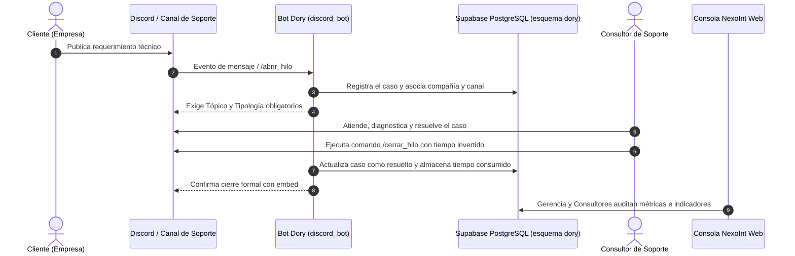

# 📋 Auditoría y Guía de Tareas — Fase I: Modelo de Negocio y Diagramas
> **Asignación:** Jesús Hernández (con apoyo de Albany Reyes)  
> **Área:** Modelo del Negocio (Sección III), Diagramas del Negocio (CUN y Actividad) y Metodología RECLAMO  
> **Proyecto:** Proyecto Socio Tecnológico IV (PST IV) — PNFI / UPTEP "JJ Montilla"  
> **Última Revisión:** 30 de Octubre de 2026  

---

## 📌 Estado de Avance al 30 de Octubre de 2026

Tras la auditoría técnica detallada del documento nativo (`.docx`), se verifican **avances muy importantes** en la sección de Jesús Hernández:

1. **✅ Tablas de Casos de Uso del Negocio (Tablas 6 a 9 / Cuadros N° 11 al 14): COMPLETADAS.**  
   Las 4 tablas que anteriormente estaban vacías ya fueron debidamente redactadas y estructuradas con actores, precondiciones, postcondiciones, cursos normales, alternos y reglas del negocio (RN-01 a RN-04):
   - `CU-01: Registrar caso` (Cliente / Bot Dory / Tópico y Tipología).
   - `CU-02: Gestionar caso` (Consultor / Diagnóstico / Congelamiento y cálculo de tiempo consumido).
   - `CU-03: Generar reporte` (Administrador / NexoInt / Métricas e indicadores).
   - `CU-04: Recibir reportes` (Cliente y Administración / Visualización con aislamiento seguro).
2. **✅ Diagrama de Casos de Uso del Negocio (CUN): IMAGEN INSERTADA.**  
   El gráfico fue incorporado en el Párrafo 231 del documento.
3. **✅ Metodología de Calidad RECLAMO: INCORPORADA.**  
   Redactada formalmente en la sección de desarrollo de Fase II.

---

## ⏳ Tareas Pendientes por Pulir (Pasos Finales para Jesús Hernández)

Para dar por cerrada al 100% la Sección III del Modelo de Negocio, solo quedan **3 detalles puntuales**:

---

### 1. ⚠️ Insertar la Imagen del Diagrama de Actividad (Párrafos 248 a 251)
- **Problema:** En el documento aparece el título (*"Diagrama de Actividad"*) y el párrafo introductorio, pero el espacio de la imagen quedó en blanco.
- **Acción Requerida:** Diseñar e insertar la imagen del Diagrama de Actividad del Negocio con carriles (*swimlanes*).
- **Flujo de referencia para graficar:**

- **Pie de figura:**  
  - Arriba: `Imagen N° 8: Diagrama de Actividad del Proceso de Soporte Técnico`  
  - Abajo: `Fuente: Hernández H. Jesús A. (2026).`

---

### 2. ⚠️ Rotulado Formal de la Imagen del Diagrama CUN (Párrafo 231)
- **Problema:** La imagen del Diagrama CUN está insertada, pero no tiene el número de imagen arriba ni la fuente abajo.
- **Acción Requerida:** Agregar:
  - Arriba de la imagen: `Imagen N° 7: Diagrama de Casos de Uso del Negocio (CUN)`
  - Abajo de la imagen: `Fuente: Hernández H. Jesús A. (2026).`

---

### 3. ⚠️ Actualización de Año y Título en Cuadros 11 al 14
- **Problema en Cuadro N° 11 (Párrafo 236):** El título dice incompletamente: *"Plantilla de especificación de ."*  
  👉 *Corrección:* Colocar: **"Plantilla de especificación de Registrar caso (CU-01)."**
- **Problema en Fuentes (Párrafos 237, 240, 243 y 246):** Todas las fuentes dicen `Fuente: Hernández H. Jesús A. (2025)`.  
  👉 *Corrección:* Actualizar el año a **(2026)**.
