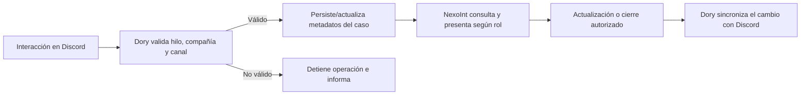

# Guía técnica de procesos — PST IV

Documento de consulta para redactar los requerimientos, casos de uso y flujos técnicos de la Fase II. Explica cómo colaboran NexoInt, Dory/Jarvis, Discord y Supabase desde la perspectiva del sistema; no requiere que el equipo académico lea el código fuente. Los estados indicados como «en desarrollo» o «por validar» no deben presentarse como capacidades entregadas.

## 1. Componentes y límites

| Componente | Responsabilidad en el proceso | Límite importante |
|---|---|---|
| **NexoInt Web** | Interfaz interna para consultar y administrar casos, catálogos, permisos, calendario, indicadores, reportes, releases y consola NexoKube. | Es una aplicación web; la autorización efectiva también depende de las políticas de datos y de las APIs. No es un backend/API Gateway propio. |
| **Dory en Discord** | Recibe interacciones y mensajes, abre y sincroniza hilos, actualiza casos, publica respuestas/archivos y realiza seguimientos. | Discord conserva la conversación. El modelo de datos del caso no debe tratarse como copia canónica de todo el historial. |
| **API de Dory** | Expone operaciones autorizadas sobre conversaciones, mensajes y adjuntos de Discord a NexoInt e integraciones con permisos. | Distinguir el ID de hilo de Discord del identificador interno `dory_thread_id`; el primero se usa para ubicar el hilo remoto. |
| **Jarvis** | Automatiza tareas de repositorios/releases: reúne evidencia, genera borradores y coordina publicación y callbacks de Actions. | Una nota generada requiere revisión; no inferir cambios funcionales cuando la evidencia no los respalda. |
| **Supabase (esquema `dory`)** | Identidad de la aplicación y persistencia de casos, catálogos, permisos, reportes y configuración. | El diccionario local es una referencia; tipos y políticas deben verificarse contra migraciones y ambiente vigente. |
| **App móvil y acceso de compañías** | Líneas planificadas/en desarrollo. | No describirlas como entregadas ni inventar pantallas o funciones sin aprobación. |

## 2. Ciclo de vida de un ticket o solicitud interna

1. El cliente o consultor inicia el caso en Discord mediante el flujo habilitado.
2. Dory resuelve la compañía y el canal asociados al hilo. La relación debe validarse usando los identificadores estables de Discord, no solo el nombre visible. Si no se resuelve de forma consistente, se detiene la creación/sincronización y se informa el problema.
3. El caso se persiste en Supabase con el ID del hilo de Discord y los metadatos disponibles. La fecha de creación debe representar la apertura original, incluso si se sincroniza más tarde.
4. NexoInt presenta y permite gestionar el caso de acuerdo con los permisos del rol. Tickets de clientes y solicitudes internas se distinguen mediante su indicador y no se mezclan en reportes/filtros que los excluyen.
5. Los cambios de consultor, compañía, canal, estado de atención, `Pendiente por`, tiempo consumido y cierre son datos/acciones separados. Un mensaje de una persona en el hilo no la convierte automáticamente en consultor asignado.
6. El estado abierto/cerrado es independiente del estado de atención y de quién tiene la próxima acción. La documentación de requisitos debe conservar estas distinciones.
7. Una sincronización repetida debe reconocer el caso existente, no reemplazar datos válidos ni volver a enviar avisos duplicados. El resultado del intento debe ser entendible para quien opera el comando.

## 3. Seguimiento asistido de Dory

- **“Nudge” (mensaje contextual de seguimiento):** es un recordatorio que Dory redacta y envía en el hilo cuando el caso requiere una actualización o una respuesta. Debe considerar la conversación reciente, quién tiene la próxima acción y qué quedó pendiente; por ejemplo, pedir el resultado de pruebas acordadas. No es solo un aviso de que pasó cierto tiempo y no equivale a cerrar el caso.
- **Inactividad y reglas:** el envío depende de la política y las condiciones configuradas. Debe evitar mensajes genéricos o repetidos y respetar horario local y feriados cuando aplique; los intervalos exactos se verifican en el ambiente vigente.
- **Intención de cierre:** es una decisión distinta del recordatorio. Frases como “cerremos este caso” o “lo reportamos en un hilo nuevo” pueden indicar cierre; la lógica de intención no se mezcla con el temporizador de inactividad.
- **Contexto del mensaje:** antes de responder, identificar quién debe actuar, qué quedó pendiente y si el consultor indicó que continuará pruebas o espera información. Evitar menciones incorrectas o anuncios de asignación cuando el caso ya está cerrado.
- **Calendario laboral:** los seguimientos deben considerar horario local y feriados cuando la política así lo establezca; el horario concreto debe verificarse con la configuración vigente, no asumirlo en el documento.

## 4. Conversaciones y archivos

NexoInt solicita a la API de Dory la conversación asociada al ID de Discord. La API devuelve mensajes paginados, autores, fechas y adjuntos; operaciones de escritura requieren permiso de escritura y verifican el estado del ticket. El historial se consulta en Discord en vez de guardarse como una segunda transcripción en Supabase. Los errores de autorización, ticket cerrado, hilo inaccesible, adjunto fuera de límites o Discord no disponible deben convertirse en resultados claros para el usuario.

Referencia de proceso: [API de Dory: conversaciones y mensajes](./referencias-tecnicas/api-dory-conversaciones.md).

## 5. Publicación y documentación de releases (Jarvis)

1. Se seleccionan repositorio y tag/release objetivo entre los repositorios configurados.
2. Jarvis determina la base de comparación con evidencia del historial disponible y obtiene cambios/commits relevantes; no debe comparar el tag consigo mismo ni declarar “sin cambios” solo por no hallar un release anterior.
3. Para proyectos agregadores, la nota puede incorporar evidencia del Patch y de los XML aplicables. Los XML se localizan a partir del rango real entre versiones; el resultado debe enlazar la evidencia y distinguir release propio, dependencia y cambio heredado.
4. Se excluyen candidatos/pre-releases y tags `OLD-UI` cuando la consulta solicite omitirlos.
5. La IA redacta un borrador funcional y enlaces relacionados. No debe agregar texto de relleno sobre “actualización de componente” ni atribuir cambios a una persona sin evidencia.
6. La publicación en GitHub Actions registra el tag y el resultado real de los jobs de publicación; una notificación exitosa no sustituye validar que el artefacto fue publicado.

Referencias: [proceso de releases de Jarvis](./referencias-tecnicas/jarvis-releases.md) y [uso de IA en Dory y Jarvis](./referencias-tecnicas/ia-dory-jarvis.md).

## 6. NexoInt: permisos, calendario, reportes e indicadores

- **Permisos:** el rol determina acceso por ventana y acciones. La UI no debe ser la única barrera: las escrituras también requieren políticas/autorización de API. Requisitos y casos de uso deben documentar escenarios permitidos y denegados.
- **Calendario:** agrupa actividades, guardias, feriados y cumpleaños. La visibilidad de cumpleaños depende del acceso a Empleados; el estado de un evento vencido puede limitar edición según sus reglas.
- **Indicadores:** el Panel de Soporte y Actividad de Consultores separan tickets de solicitudes internas y aplican filtros de compañía, canal, período, estado y consultor. El dato de consultor actual no reconstruye el histórico de asignaciones.
- **Aportes GitHub:** se consultan solo para repositorios configurados. Son una dimensión complementaria de actividad, no una calificación automática de calidad individual.
- **Reportes:** los filtros forman parte de la consulta y deben conservar su contexto al abrir un resultado o volver al reporte. Exportación/impresión debe respetar columnas, formato y enlaces disponibles.

## 7. Consola NexoKube

La consola se integra con una API protegida por sesión y rol. Permite inspeccionar clústeres configurados y recursos autorizados, entre ellos namespaces, pods, deployments/statefulsets, configuración, logs y estado de salud. Las acciones de escalar, reiniciar, cambiar imagen o editar manifiestos son mutaciones administrativas y requieren controles explícitos; no asumir que todo rol con lectura puede ejecutarlas. La app móvil no forma parte de esta consola web.

Referencia operativa: [consola NexoKube](./referencias-tecnicas/nexokube.md).

## 8. Trazabilidad que debe incluir Daniel

Para cada RF, RNF y CUS, registrar:

1. Actor y permisos requeridos.
2. Precondiciones y datos de entrada.
3. Flujo normal entre Discord/Dory, NexoInt y Supabase cuando aplique.
4. Validaciones, errores, reintentos y resultado esperado.
5. Datos persistidos frente a datos obtenidos desde Discord/GitHub.
6. Estado: implementado según la evidencia técnica proporcionada, pendiente de validación en el despliegue o en desarrollo; Daniel no necesita inspeccionar el código para asignar esta clasificación.
7. Evidencia documental y fecha de consulta.

La gestión de contratos, bolsas de horas, recibos/facturación y marcajes queda fuera del alcance de estos requerimientos. El tiempo consumido asociado a un caso es operativo, no un débito contractual.
