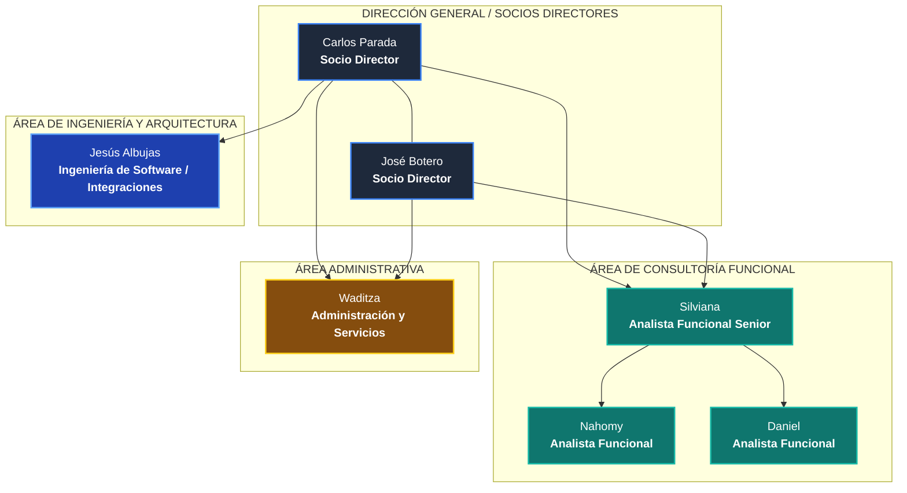

# 📋 Estructura y Jerarquía del Organigrama Empresarial 2026
> **Organización:** ERP Consultores y Asociados C.A.  
> **Uso:** Imagen N° 2 del documento oficial de PST IV (Google Docs)  
> **Elaborado para:** Albany Reyes / Equipo de Fase I  

---

## 🏢 Jerarquía y Líneas de Mando Reales (2026)

Para corregir el organigrama en el documento (que erróneamente agrupó a todos como analistas funcionales y subordinó roles independientes), se define la estructura organizacional real:

1. **Nivel Directivo / Socios Principales (Cabecera):**
   - **Carlos Parada** (Socio Director / Operaciones y Tecnología).
   - **José Botero** (Socio Director / Consultoría y Negocios).

2. **Ramas Departamentales Directas:**
   - **Rama de Consultoría Funcional y Soporte:**
     - Coordinación / Analista Funcional Senior: **Silviana**.
     - Consultores / Analistas Funcionales: **Nahomy** y **Daniel**.
   - **Rama Técnica Especializada / Arquitectura e Integraciones:**
     - Dependencia directa de Carlos Parada: **Jesús Albujas** (Desarrollo, Arquitectura de Sistemas y Automatización).
   - **Rama Administrativa / Gestión:**
     - Dependencia directa de Dirección: **Waditza** (Administración y Gestión de Servicios).
     *(Waditza no depende de Jesús Albujas ni Jesús Albujas depende de Waditza; ambos son departamentos independientes que reportan a la Dirección).*

---

## 📊 Diagrama del Organigrama Estructural

---

## 📝 Pie de Figura Formal para el Documento:
- **Título arriba:** `Imagen N° 2: Organigrama Estructural de ERP Consultores y Asociados C.A.`
- **Fuente abajo:** `Fuente: Reyes S. Albany A. (2026).`
