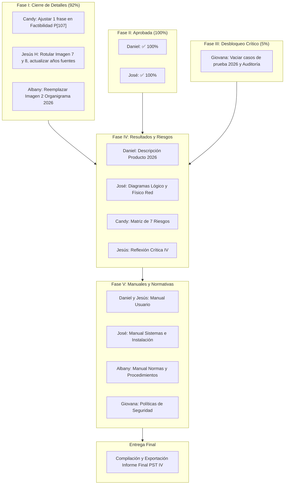

# 🚀 Plan de Trabajo, Cronograma y Calendario de Ejecución — PST IV
### Actualización y Corrección Integral de Fases I a V (Normativa PNFI 2018)
**Meta General:** Transformar el documento heredado de PST III en el informe formal de **PST IV**, corrigiendo inconsistencias, eliminando menciones desfasadas (Excel, Superset, cobros/facturación) y completando formalmente **hasta la Fase V inclusive**.  
**Fecha de Actualización y Auditoría:** **Jueves 12 de Noviembre de 2026**.  

---

## 📈 Tablero de Avance Global del Proyecto

```text
[████████████████░░░░] 80% Avance Global de Fases I, II y III

Fase I   (Diagnóstico y Negocio):  [██████████████████░░] 92%  (Avances en Actividad y Factibilidad; Falta Organigrama y Rótulos)
Fase II  (Ingeniería y Software):  [████████████████████] 100% (¡Aprobada y Cerrada al 100% por Daniel y José!)
Fase III (Pruebas y Auditoría):    [░░░░░░░░░░░░░░░░░░░░]  5%  (RETRASO CRÍTICO: Guía lista en repo, pendiente vaciado)
Fase IV  (Resultados y Logros):    [░░░░░░░░░░░░░░░░░░░░]  0%  (Texto viejo heredado en P[751-790]; listo para redistribuir)
Fase V   (Manuales y Normativas):  [░░░░░░░░░░░░░░░░░░░░]  0%  (Estructura normada PNFI 2018 lista para redactar)
```

---

## 📅 Registro de Auditoría y Verificación (12 de Noviembre de 2026)

| Integrante | Fase / Responsabilidad | Estado | % Avance | ✅ Logros Verificados en Google Docs | ⏳ Pendiente Crítico / Retraso |
| :--- | :--- | :---: | :---: | :--- | :--- |
| **Daniel Pérez** | **Fase II:** Requerimientos y CUS | **✅ 100% COMPLETADO** | **100%** | • 13 Requerimientos Funcionales (`RF-01` al `RF-13`).<br>• 15 Requerimientos No Funcionales (`RNF-01` al `RNF-15`).<br>• Fichas CUS completas.<br>• **4 diagramas CUS separados y rotulados** (`Imágenes N° 10, 11, 12 y 13`) con fuente `Pérez Daniel (2026)`. | *Ninguno (Fase II cerrada y aprobada).* |
| **José Zúñiga** | **Fase II:** Arquitectura, BD y UML | **✅ 100% COMPLETADO** | **100%** | • Arquitectura de 3 pilares (`Imagen N° 14`).<br>• Modelo de Clases (`Imagen N° 15`) y Secuencia (`Imagen N° 16`).<br>• Modelo Relacional E/R (`Imagen N° 17`) y **18 tablas de Diccionario de Datos** (Cuadros N° 20 al 37).<br>• Navegación y Carta Estructurada (`Imágenes N° 18 y 19`).<br>• Componentes y Despliegue (`Imágenes N° 20 y 21`).<br>• Reflexión Crítica de Fase II con fuente `Zúñiga S. José D. (2026)`. | *Ninguno (Fase II cerrada y aprobada).* |
| **Candy Gutiérrez** | **Fase I:** Diagnóstico, FODA y Problemas | **🔄 AVANCE AVANZADO** | **95%** | • **Matriz FODA (Cuadro N° 15): Aprobada (10/10)**.<br>• **Problema N° 2 (Cuadro N° 16): Aprobado**.<br>• **Reflexión Crítica Fase I: Aprobada**.<br>• **Texto intro Árbol del Problema (P[273]): Actualizado** (sin mención a Excel ni procesos manuales).<br>• **Factibilidad Económica P[106]: Corregido** ("gestión operativa"). | • **P[107]:** Ajustar 1 sola frase donde aún dice *"quedaban sin registrar o facturar, impactando de manera directa y favorable en la liquidez y el control financiero"* (cambiar por *"sin registrar ni auditar, impactando en el control operativo"*). |
| **Jesús Hernández** | **Fase I:** Modelo de Negocio y Diagramas | **🔄 AVANCE AVANZADO** | **90%** | • **4 Tablas CUN (`CU-01` al `CU-04`):** Completas en Cuadros 11 al 14.<br>• **Diagrama CUN:** Montado en P[231].<br>• **Diagrama de Actividad:** **¡INSERTADO!** Imagen montada con éxito en P[251] (resolvió el espacio en blanco).<br>• Metodología RECLAMO redactada. | • Agregar títulos y fuentes a las imágenes:<br>  - P[231]: `Imagen N° 7: Diagrama CUN / Fuente: Hernández H. Jesús A. (2026)`.<br>  - P[251]: `Imagen N° 8: Diagrama de Actividad / Fuente: Hernández H. Jesús A. (2026)`.<br>• Actualizar fuentes de Cuadros 11 al 14 a `(2026)`. |
| **Albany Reyes** | **Fase I:** Organigrama y Fundamentación | **⏳ PENDIENTE CRÍTICO** | **80%** | • Reseña histórica, Misión, Visión y Fundamentación Legal completas y aprobadas. | • **Imagen N° 2 (Organigrama):** Sigue la imagen de 2025 (`Fuente: Albujas R. Jesús A 2025`). Debe reemplazarse por el organigrama 2026 con las 3 ramas (Funcional, Técnica de Jesús Albujas, y Proyectos con Waditza y José Uzcátegui). |
| **Giovana Garrido** | **Fase III:** Pruebas y Auditoría | **⚠️ RETRASO CRÍTICO** | **5%** | • Guía detallada y tablas listas en el repositorio (`pst-4-auditoria-giovana-fase-3.md`). | • **No ha vaciado nada en el documento:** P[658-750] sigue teniendo el texto de diciembre de 2025 con Apache Superset, fechas viejas y facturación contable.<br>• Falta vaciar los 6 Casos de Prueba 2026 y el Informe de Auditoría Informática. |
| **Giovana Garrido** | **Fase III:** Pruebas y Auditoría | **⏳ PENDIENTE COMPLETO** | **10%** | • Guía detallada y plantillas técnicas estructuradas en el repositorio. | • Actualizar casos de prueba a 2026 (NexoInt, Discord, Jarvis, Supabase).<br>• Eliminar menciones a Superset y fechas de 2025.<br>• Incorporar Informe de Auditoría Informática (SAST/DAST y RBAC).<br>• Actualizar Reflexión Crítica de Fase III. |

---

## 👥 Detalle Individual y Mensajes para Cada Integrante

---

### 🏛️ EQUIPO FASE I — Planificación, Diagnóstico y Modelo de Negocio

---

#### 👤 1. Jesús Hernández (Coordinación de Fase I, Metodología y Procesos)

> **Estado:** **🔄 EN AVANCE AVANZADO (02/11/2026)**  
> **Guía Asignada:** 📖 Consultar [Auditoría y Guía de Tareas - Jesús Hernández](./pst-4-auditoria-jesus-h-fase-1.md)  
> **✅ Verificado y Listo:**
> - [x] **Plantillas CUN (Cuadros N° 11 al 14 / Tablas 6 a 9):** Vaciadas y completadas con éxito (`CU-01 Registrar caso`, `CU-02 Gestionar caso`, `CU-03 Generar reporte`, `CU-04 Recibir reportes`).
> - [x] **Diagrama CUN:** Imagen incorporada en el Párrafo 231.
> - [x] **Metodología de Calidad RECLAMO:** Redactada en la sección correspondiente.

> [!NOTE]
> **⏳ Tareas pendientes por corregir (Jesús Hernández):**  
> 1. **Falta la Imagen del Diagrama de Actividad:** El título está en el Párrafo 248, pero entre P[249] y P[252] no hay imagen (el espacio quedó en blanco).  
> 2. **Rotulado de la Imagen del CUN:** Agregar arriba `Imagen N° 7: Diagrama de Casos de Uso del Negocio (CUN)` y abajo `Fuente: Hernández H. Jesús A. (2026)`.  
> 3. **Actualizar Año en Cuadros 11 al 14:** Las fuentes de las plantillas CUN dicen *(2025)*; deben actualizarse a *(2026)*. En el Cuadro 11 corregir el título (*Plantilla de especificación de Registrar caso*).

<details>
<summary><b>📂 Ver Detalle Técnico de Tareas de Jesús Hernández</b></summary>
<br>

* **Responsabilidad Principal:** Coordinar la estructuración del Modelo de Negocio (Sección III) y la metodología de calidad RECLAMO.
* **Guía de Apoyo:** Ver [Sección 2 de pst-4-arquitectura.md](./pst-4-arquitectura.md#2-fase-i-planificación-diagnóstico-y-modelo-de-negocio).
* **Flujograma para el Diagrama de Actividad:**
  - Cliente reporta en Discord ➔ Bot Dory abre hilo y exige Tópico/Tipología ➔ Consultor atiende y ejecuta `/cerrar_hilo` con tiempo consumido ➔ Supabase almacena caso y tiempos ➔ NexoInt despliega métricas a gerencia.

</details>

---

#### 👤 2. Albany Reyes (Contexto Empresarial, Organigrama y Fundamentación Legal)

> **Estado:** **⏳ PENDIENTE CRÍTICO DE CORRECCIÓN (02/11/2026)**  
> **Guía Asignada:** 📖 Consultar [Auditoría y Guía de Tareas - Albany Reyes](./pst-4-auditoria-albany-fase-1.md) y [Guía de Organigrama 2026](./pst-4-organigrama-guia.md)  
> **✅ Verificado y Listo:**
> - [x] **Reseña Histórica, Misión y Visión:** Redactadas y aprobadas.
> - [x] **Fundamentación Legal:** Citas de CRBV Art. 110, Ley de Infogobierno, Decreto 3.390, Plan de la Patria y LOCTI completas.

> [!WARNING]
> **⏳ Tarea Crítica Pendiente (Albany Reyes):**  
> **Reemplazar la Imagen N° 2 del Organigrama:** La imagen actual sigue teniendo fecha vieja *(2025)* y un error de jerarquía donde todos están como analistas funcionales y Waditza depende de Jesús Albujas.  
> 
> *Estructura 2026 que debe montar en la imagen:*
> - **Dirección General:** Carlos Parada y José Botero (Socios Directores).
> - **Rama 1 (Consultoría Funcional):** Silviana (Senior) ➔ Nahomy y Daniel.
> - **Rama 2 (Ingeniería e Integraciones):** Jesús Albujas (independiente).
> - **Rama 3 (Gestión de Proyectos):** Waditza (Líder de Proyectos) ➔ José Uzcátegui (Analista de Proyectos).
> - **Pie de figura:** `Imagen N° 2: Organigrama Estructural... Fuente: Reyes S. Albany A. (2026).`

---

#### 👤 3. Candy Gutiérrez (Diagnóstico Situacional, FODA y Árbol de Problemas)

> **Estado:** **🔄 EN AVANCE AVANZADO (02/11/2026)**  
> **Guía Asignada:** 📖 Consultar [Auditoría y Correcciones Fase I - Candy Gutiérrez](./pst-4-auditoria-candy-fase-1.md)  
> **✅ Verificado y Listo:**
> - [x] **Matriz FODA (Cuadro N° 15 / Tabla 10): APROBADA (10/10)**, sin menciones a Excel ni facturación, alineada a Discord/NexoInt/Supabase/Jarvis.
> - [x] **Tabla de Jerarquización de Problemas (Cuadro N° 16 / Tabla 11): APROBADA**. El Problema N° 2 quedó corregido como: *"Dificultad para auditar y consolidar los tiempos operativos invertidos por el personal técnico en la atención de casos"*.
> - [x] **Reflexión Crítica de Fase I (Párrafo 283): APROBADA**. Texto nuevo formal sin términos contables ni hojas de cálculo.
> - [x] **Estudio de Factibilidad:** Redactadas las 4 dimensiones (Social, Económica, Técnica y Operativa).

> [!NOTE]
> **⏳ Tareas pendientes por pulir (Candy Gutiérrez):**  
> 1. **Texto del Árbol del Problema (Párrafo 273):** Cambiar la frase que dice *"la problemática central de la empresa (la gestión manual)..."* por *"la fragmentación en el seguimiento administrativo y carencia de una consola web centralizada"*.  
> 2. **Factibilidad Económica (Párrafos 106-107):** Reemplazar las dos frases de *"procesos administrativos y de facturación"* y *"horas que anteriormente quedaban sin registrar o facturar"* por *"procesos de auditoría operativa"* y *"horas que anteriormente quedaban sin trazabilidad formal"*.

---

### ⚙️ EQUIPO FASE II — Requerimientos y Diseño Técnico (Software)

---

#### 👤 4. Daniel Pérez (Especificación Técnica, Requerimientos y Casos de Uso)

> **Estado:** **✅ 100% COMPLETADO Y APROBADO (02/11/2026)**  
> **✅ Verificado y Listo:**
> - [x] **13 Requerimientos Funcionales (`RF-01` al `RF-13`):** Vaciados bajo plantilla formal PNFI (Entradas, Procesos, Salidas, Actores).
> - [x] **15 Requerimientos No Funcionales (`RNF-01` al `RNF-15`):** Criterios de verificación medibles de seguridad, aislamiento y rendimiento.
> - [x] **Fichas Técnicas de Casos de Uso (CUS):** Flujos principales, alternos y reglas de negocio.
> - [x] **4 Diagramas de Casos de Uso debidamente separados y titulados:**  
>   - `Imagen N° 10: Gestión de soporte y seguimiento de casos` (Fuente: Pérez Daniel, 2026).  
>   - `Imagen N° 11: Integración con Discord y API de Dory` (Fuente: Pérez Daniel, 2026).  
>   - `Imagen N° 12: Asistencia contextual de Dory` (Fuente: Pérez Daniel, 2026).  
>   - `Imagen N° 13: Jarvis, Informes y NexoKube` (Fuente: Pérez Daniel, 2026).

---

#### 👤 5. José Zúñiga (Ingeniería Técnica, Arquitectura y Modelo de Datos)

> **Estado:** **✅ 100% COMPLETADO Y APROBADO (02/11/2026)**  
> **✅ Verificado y Listo:**
> - [x] **Visión Arquitectónica General:** Detallados los 3 pilares (`NexoInt Web`, `discord_bot / Dory / Jarvis`, `Supabase Cloud esquema dory`) y delimitación de módulos en desarrollo (`Imagen N° 14`).
> - [x] **Modelo de Clases y Objetos:** 4 paquetes lógicos documentados con la `Imagen N° 15: Diagrama de Clases y Dominio`.
> - [x] **Comportamiento Dinámico:** Flujo transaccional con la `Imagen N° 16: Diagrama de Secuencia Global`.
> - [x] **Modelo de Datos Relacional:** `Imagen N° 17: Modelo Entidad-Relación (Esquema dory)`.
> - [x] **Diccionario de Datos Exhaustivo:** 18 tablas detalladas (Cuadros N° 20 al 37: `dory_client`, `dory_channel`, `dory_thread`, `dory_message`, `dory_changelog`, etc.).
> - [x] **Mapa de Navegación y Carta Estructurada:** `Imagen N° 18` (Navegación Web) e `Imagen N° 19` (Carta Estructurada).
> - [x] **Interfaz de Usuario y Formularios:** Vistas web y comandos slash en Discord.
> - [x] **Diagrama de Componentes y Despliegue:** `Imagen N° 20: Diagrama de Componentes` e `Imagen N° 21: Diagrama de Despliegue`.
> - [x] **Reflexión Crítica de la Fase II:** Redactada con enfoque formal de Trayecto IV.  
*(Todas las figuras y tablas debidamente rotuladas con Fuente: Zúñiga S. José D. 2026).*

---

### 🧪 EQUIPO FASE III — Implantación, Pruebas y Auditoría

---

#### 👤 6. Giovana Garrido (Pruebas del Sistema y Auditoría Informática)

> **Estado:** **⏳ PENDIENTE COMPLETO DE ACTUALIZACIÓN (02/11/2026)**  
> **Guía Asignada:** 📖 Consultar [Auditoría y Guía de Tareas - Giovana Garrido (Fase III)](./pst-4-auditoria-giovana-fase-3.md)  
> **Diagnóstico del Documento:** La Fase III (Párrafos 658 al 750) conserva el texto viejo de diciembre de 2025 que menciona Apache Superset y pruebas viejas de PST III.

> [!WARNING]
> **⏳ Tareas Requeridas para Giovana Garrido:**  
> 1. **Actualizar Casos de Prueba a 2026:** Eliminar menciones a Apache Superset y fechas de 2025. Incorporar pruebas de:
>    - Creación de caso por Discord (`/abrir_hilo`).
>    - Cierre de caso con tiempo consumido (`/cerrar_hilo`).
>    - Visualización de indicadores y reportes en `NexoInt Web` (sustituye a Superset).
>    - Releases con Jarvis en GitHub.
> 2. **Estrategias de Implantación:** Documentar el despliegue del ecosistema (Frontend React/Vite en Nginx, demonio `discord_bot` en Node.js, y Supabase Cloud con RLS).
> 3. **Informe de Resultados de Auditoría Informática (Exigido en Trayecto IV):**
>    - Auditoría de autenticación y tokens JWT (Supabase Auth).
>    - Control de acceso dinámico por roles (RBAC) en NexoInt.
>    - Análisis SAST/DAST (prevención de SQLi y protección de variables `.env`).
>    - Auditabilidad en `dory_changelog`.
> 4. **Actualizar Reflexión Crítica de Fase III:** Eliminar las fechas de 2025 y las menciones a Superset, enfocándola en los resultados de pruebas y auditoría 2026.

---

## 🎯 Planificación y Redistribución de "Lo Siguiente" del Informe (Fases IV y V)
Conforme a la **Normativa Oficial PNFI 2018 (Trayecto IV)**, una vez cerradas las fases de ingeniería (Fases I a III), el informe formal exige las dos fases finales de entrega y cierre:

```
┌────────────────────────────────────────────────────────────────────────┐
│             REDISTRIBUCIÓN INTEGRAL DE FASES IV Y V (PNFI 2018)        │
├───────────────────────────────┬──────────────────────────┬─────────────┤
│ SECCIÓN FORMAL DEL INFORME    │ INTEGRANTE RESPONSABLE   │ ESTADO      │
├───────────────────────────────┼──────────────────────────┼─────────────┤
│ 1. Fase IV: Descripción del   │ • Daniel Pérez           │ 🚀 ASIGNADO │
│    Producto y Desempeño       │                          │             │
│ 2. Fase IV: Diagramas Lógico  │ • José Zúñiga            │ 🚀 ASIGNADO │
│    y Físico de la Red         │                          │             │
│ 3. Fase IV: Matriz Integral   │ • Candy Gutiérrez        │ 🚀 ASIGNADO │
│    de Factores de Riesgos     │                          │             │
│ 4. Fase IV: Reflexión Crítica │ • Jesús Hernández        │ 🚀 ASIGNADO │
│    de la Fase IV              │                          │             │
├───────────────────────────────┼──────────────────────────┼─────────────┤
│ 5. Fase V: Manual de Usuario  │ • Daniel Pérez y         │ 🚀 ASIGNADO │
│    (NexoInt Web + Bot Dory)   │   Jesús Hernández        │             │
│ 6. Fase V: Manual de Sistemas │ • José Zúñiga            │ 🚀 ASIGNADO │
│    e Instalación (DevOps/DB)  │                          │             │
│ 7. Fase V: Manual de Normas y │ • Albany Reyes           │ 🚀 ASIGNADO │
│    Procedimientos Operativos  │                          │             │
│ 8. Fase V: Políticas y        │ • Giovana Garrido        │ 🚀 ASIGNADO │
│    Estándares de Seguridad    │                          │             │
└───────────────────────────────┴──────────────────────────┴─────────────┘
```

---

### 🌐 FASE IV — RESULTADOS Y LOGROS DEL PROYECTO (Desglose de Tareas)

#### 👤 1. Daniel Pérez — Descripción del Producto y Mejora del Desempeño
* **Ubicación en Doc:** Párrafos 753 al 771.
* **Acción Crítica:** Purgar todo el texto viejo de PST III que menciona Apache Superset y Django.
* **Contenido a Redactar:**
  - Descripción integral del ecosistema 2026: Frontend Web React/Vite (`NexoInt`), demonio bot en Node.js (`Dory`), agente de automatización GitHub Octokit (`Jarvis`) y backend relacional en Supabase (`esquema dory`).
  - Proceso de optimización de la atención: Trazabilidad en tiempo real, eliminación de la fragmentación de canales y registro exacto del esfuerzo técnico mediante `/cerrar_hilo`.

#### 👤 2. José Zúñiga — Diagramas Lógico y Físico de la Red
* **Ubicación en Doc:** Párrafos 772 al 775.
* **Acción Crítica:** Sustituir los esquemas obsoletos de red local por la topología real de microservicios en la nube.
* **Contenido a Redactar:**
  - **Diagrama Lógico de Red:** Flujo de peticiones cifradas (HTTPS/WSS), Discord Gateway API, Supabase PostgREST API, autenticación JWT, y comunicación con la API de NexoInt.
  - **Diagrama Físico de Infraestructura:** Servidores de alojamiento (VPS / Cloud), contenedor Docker con Nginx y Node.js, balanceador de carga, base de datos gestionada PostgreSQL y terminales de clientes/consultores.

#### 👤 3. Candy Gutiérrez — Matriz Integral de Evaluación de Riesgos
* **Ubicación en Doc:** Párrafos 776 al 789.
* **Acción Crítica:** Eliminar los riesgos viejos basados en *"transcripción de Discord a Excel"*, *"pérdidas por errores manuales en hojas de cálculo"* y *"preparación de facturación"*.
* **Contenido a Redactar:**
  - Matriz formal con probabilidad, impacto y plan de mitigación en 7 dimensiones:
    1. **Riesgo Tecnológico:** Caídas de conectividad con la API de Discord o indisponibilidad de Supabase Cloud.
    2. **Riesgo de Seguridad / Ciberseguridad:** Fuga de Service Role Keys, exposición de tokens de bot o escalamiento de privilegios.
    3. **Riesgo Operativo:** Omisión involuntaria de consultores al clasificar la tipología del ticket o cerrar el tiempo de atención.
    4. **Riesgo Legal / Cumplimiento:** Protección de datos sensibles de clientes corporativos en hilos de soporte (conforme a la Ley de Infogobierno).
    5. **Riesgo Social y Organizacional:** Resistencia inicial al cambio por parte de consultores acostumbrados a canales informales.
    6. **Riesgo Financiero / Económico:** Desviación en el consumo de cuotas de cómputo en servidores cloud.
    7. **Riesgo Ambiental:** Eficiencia energética y consumo en infraestructura compartida de centros de datos ecológicos.

#### 👤 4. Jesús Hernández — Reflexión Crítica de la Fase IV
* **Ubicación en Doc:** Párrafos 790 al 800.
* **Contenido a Redactar:**
  - Evaluación crítica del salto cualitativo logrado entre la situación inicial fragmentada y el ecosistema modular desplegado.
  - Análisis de lecciones aprendidas en la integración multiplataforma (Discord + Web + Cloud Database).

---

### 📚 FASE V — MANUALES Y NORMATIVAS (Desglose de Tareas)

#### 👤 5. Daniel Pérez y Jesús Hernández — Manual de Usuario
* **Daniel Pérez:** Manual de Usuario de `NexoInt Web` (Inicio de sesión, navegación por dashboard, consulta de métricas de horas, filtrado de tickets por cliente y exportación de reportes).
* **Jesús Hernández:** Manual de Operación de `Dory en Discord` (Guía de comandos slash `/abrir_hilo`, `/cerrar_hilo`, `/tiempo`, reglas de tipificación y buenas prácticas para consultores).

#### 👤 6. José Zúñiga — Manual de Sistemas e Instalación (DevOps / DBA)
* **Manual de Instalación:** Despliegue con Docker, variables de entorno requeridas (`.env.example`), ejecución de scripts de migración del esquema `dory` y aprovisionamiento en Nginx.
* **Manual de Sistemas:** Arquitectura de microservicios, estructura de carpetas del repositorio, endpoints de la API, políticas Row Level Security (RLS) y plan de respaldos automatizados.

#### 👤 7. Albany Reyes — Manual de Normas y Procedimientos
* Documentar las políticas internas para la empresa **ERP Consultores y Asociados C.A.**:
  - Procedimiento formal de atención al cliente (Nivel 1: Consultor de guardia; Nivel 2: Senior/Especialista; Nivel 3: Desarrollo/Ingeniería).
  - Tiempos máximos de respuesta (SLA operativo) y directrices para la congelación y reactivación de casos.

#### 👤 8. Giovana Garrido — Políticas y Estándares de Seguridad Informática
* Redactar el marco normativo de ciberseguridad del sistema:
  - Políticas de contraseñas y expiración de sesiones JWT.
  - Reglas de control de acceso basado en roles (RBAC).
  - Política de resguardo de variables de entorno y rotación periódica de tokens de bot de Discord.
  - Plan de contingencia y respuesta ante incidentes de fuga de datos.

---

## 📅 Cronograma y Ruta Crítica de Cierre


