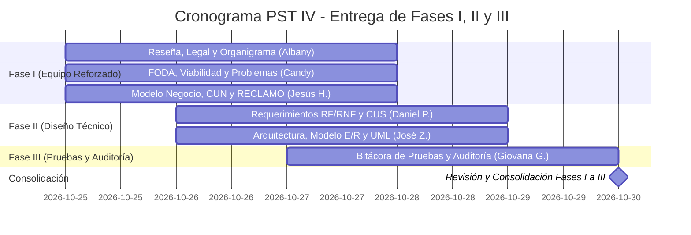

# 🚀 Plan de Trabajo y Cronograma — PST IV
### Actualización y Corrección Integral de Fases I, II y III
**Meta de la Semana:** Transformar el documento actual (heredado de PST III) en el informe real de **PST IV**, corrigiendo inconsistencias, eliminando menciones viejas a Excel/Superset y completando formalmente **hasta la Fase III inclusive** con base en el **Esquema Oficial PNFI 2018**.  
**Fecha Límite:** **Viernes 30 de Octubre de 2026**.  

---

## 👥 Asignación de Tareas por Fases y Habilidades

Para avanzar de forma organizada y sin cuellos de botella, las tareas se dividen entre los **6 integrantes** según su perfil: las partes analíticas/descriptivas van para el equipo de Fase I, y las partes técnicas para quienes dominan modelado e ingeniería.

---

### 🏛️ EQUIPO FASE I — Planificación, Diagnóstico y Modelo de Negocio
*El documento de Google Docs actual tiene la Fase I desfasada (con referencias viejas a 2025 y flujos manuales de PST III). Se reforzó este equipo con 3 integrantes para dejar la Fase I impecable.*

#### 👤 1. Jesús Hernández (Coordinación de Fase I, Metodología y Modelo de Negocio)
* **Responsabilidad Principal:** Estructurar el nuevo modelo de negocio y la metodología.
* **Tareas a Ejecutar:**
  1. **Reescribir el Modelo de Negocio:** Eliminar cualquier mención a transcripción manual en Excel o Superset como núcleo. Describir el nuevo flujo tri-modular de PST IV: **Discord Bot $\leftrightarrow$ NexoInt Core $\leftrightarrow$ Base de Datos $\leftrightarrow$ Clientes**.
  2. **Diagramas del Negocio:** Transcribir e incorporar el **Mapa de Procesos** y el **Diagrama de Casos de Uso del Negocio (CUN)**.
     - 📖 *¿Dónde consultar la información?* Ver [Sección 2.3 y 2.4 de pst-4-arquitectura.md](./pst-4-arquitectura.md#23-mapa-y-flujograma-de-procesos-de-negocio).
  3. **Metodología de Calidad RECLAMO (Fase II):** Redactar la justificación y aplicación del estándar venezolano de calidad RECLAMO (exigido en Trayecto IV).
  4. **Reflexión Crítica de la Fase I.**
* **Plazo de Entrega:** **Miércoles 28 de Octubre - 06:00 PM**

#### 👤 2. Albany Reyes (Contexto Empresarial, Reseña y Fundamentación Legal)
* **Responsabilidad Principal:** Redacción descriptiva, reseña y bases legales (sin tecnicismos de código).
* **Tareas a Ejecutar:**
  1. **Actualización de Reseña y Organigrama:** Describir la empresa ERP Consultores y Asociados C.A., misión, visión y actualizar el organigrama estructural al año 2026.
     - 📖 *¿Dónde consultar la información?* Ver [Sección 2.1 de pst-4-arquitectura.md](./pst-4-arquitectura.md#21-contexto-y-diagnóstico-situacional-participativo).
  2. **Fundamentación Legal:** Redactar la vinculación formal con:
     - Constitución de la República Bolivariana de Venezuela (Art. 110).
     - Ley de Infogobierno y Decreto N° 3.390 (Software Libre).
     - Plan de la Patria (Objetivos históricos de soberanía tecnológica).
     - Ley Orgánica de Ciencia, Tecnología e Innovación (LOCTI).
  3. **Corrección de Forma y Redacción:** Leer y corregir ortografía y coherencia en toda la Fase I.
* **Plazo de Entrega:** **Miércoles 28 de Octubre - 06:00 PM**

#### 👤 3. Candy Gutiérrez (Diagnóstico Situacional, FODA y Árbol de Problemas)
* **Responsabilidad Principal:** Formulación analítica del problema y viabilidad.
* **Tareas a Ejecutar:**
  1. **Matriz FODA:** Actualizar las Fortalezas, Oportunidades, Debilidades y Amenazas de ERP Consultores y Asociados C.A. enfocadas en la nueva arquitectura.
     - 📖 *¿Dónde consultar la información?* Ver [Sección 2.5 de pst-4-arquitectura.md](./pst-4-arquitectura.md#25-matriz-foda-y-árbol-del-problema).
  2. **Tabla de Jerarquización de Problemas y Árbol del Problema:** Transcribir y explicar las causas raíz (dispersión de canales, falta de API unificada) y los efectos (retrasos en SLAs, fricción en facturación).
  3. **Estudio de Factibilidad:** Redactar la factibilidad técnica, económica, operativa y social del proyecto.
* **Plazo de Entrega:** **Miércoles 28 de Octubre - 06:00 PM**

---

### ⚙️ EQUIPO FASE II — Requerimientos y Diseño Técnico (Software)

#### 👤 4. Daniel Pérez (Requerimientos del Software y Casos de Uso CUS)
* **Responsabilidad Principal:** Especificación formal con plantillas PNFI.
* **Tareas a Ejecutar:**
  1. **Requerimientos Funcionales (RF):** Llenar las fichas oficiales del PNFI para:
     - `RF-01`: Autenticación OAuth 2.0 (Google y Discord).
     - `RF-02`: Gestión y apertura de tickets en Discord (`/abrir_hilo`).
     - `RF-03`: Cierre de hilos e imputación de horas (`/cerrar_hilo`).
     - `RF-04`: Asignación de consultores con asistencia IA (`/asignar_consultor`).
     - `RF-05`: Generación automatizada de Release Notes (`jarvis`).
     - `RF-06`: Gestión de contratos de servicio y bolsas de horas en NexoInt.
  2. **Requerimientos No Funcionales (RNF):** Fichas de Seguridad (NIST 800-63B / OWASP), Disponibilidad (24/7 en VPS), Rendimiento y Portabilidad.
  3. **Casos de Uso del Software (CUS):** Redactar las plantillas de casos de uso (actores, precondiciones, flujo principal y excepciones).
* **Plazo de Entrega:** **Jueves 29 de Octubre - 06:00 PM**

#### 👤 5. José Zúñiga (Ingeniería Técnica, Arquitectura y Modelo de Datos)
* **Responsabilidad Principal:** Diagramas UML, modelo relacional y diseño técnico.
* **Tareas a Ejecutar:**
  1. **Arquitectura del Software (3 Pilares):** Describir `nexoint`, `discord_bot`/`jarvis` y `NexoInt`.
     - 📖 *¿Dónde consultar la información?* Ver [Sección 3.1 y 3.2 de pst-4-arquitectura.md](./pst-4-arquitectura.md#31-visión-arquitectónica-general).
  2. **Modelo E/R y Diccionario de Datos:** Transcribir el modelo del esquema `dory` (PostgreSQL 16 en Supabase) y la tabla de entidades.
     - 📖 *¿Dónde consultar la información?* Ver [Diccionario de Datos en database/README.md](../database/README.md).
  3. **Diagramas de Ingeniería:** Diagrama de Componentes, Diagrama de Despliegue y Diagrama de Secuencia Global.
     - 📖 *¿Dónde consultar la información?* Ver [Sección 3.5 y 3.6 de pst-4-arquitectura.md](./pst-4-arquitectura.md#35-diagrama-de-interacción-y-flujo-de-datos-global).
  4. **Reflexión Crítica de la Fase II.**
* **Plazo de Entrega:** **Jueves 29 de Octubre - 06:00 PM**

---

### 🧪 EQUIPO FASE III — Implantación, Pruebas y Auditoría

#### 👤 6. Giovana Garrido (Pruebas del Sistema y Auditoría Informática)
* **Responsabilidad Principal:** Casos de prueba actualizados y reporte formal de auditoría.
* **Tareas a Ejecutar:**
  1. **Actualizar Casos de Prueba:** Corregir las fechas de 2025 del documento viejo por pruebas de 2026. Agregar casos de prueba reales para la creación de tickets en Discord, cálculo de horas en `dory_charge` y login OAuth.
  2. **Pruebas de Integración y Carga:** Simulación de concurrencia y latencias de respuesta (< 250ms).
  3. **Informe de Resultados de Auditoría Informática (Exigido en Trayecto IV):**
     - Análisis de vulnerabilidades SAST y DAST.
     - Auditoría de control de accesos (tokens JWT, RBAC dinámico por ventanas).
     - Políticas de respaldo automatizado y recuperación (RPO < 2 horas, RTO < 30 minutos).
     - 📖 *¿Dónde consultar la información?* Ver [Sección 4 de pst-4-arquitectura.md](./pst-4-arquitectura.md#4-fase-iii-estrategias-de-implantación-pruebas-y-auditoría-informática).
  4. **Reflexión Crítica de la Fase III.**
* **Plazo de Entrega:** **Viernes 30 de Octubre - 12:00 PM (Mediodía)**

---

## 📅 Cronograma de Entrega (Semana al Viernes 30 de Octubre)

| Día | Meta del Día |
| :--- | :--- |
| **Lunes 26 / Martes 27** | Arranque de la reescritura de Fase I (Albany, Candy y Jesús H.) y vaciado de requerimientos (Daniel P.). |
| **Miércoles 28 (06:00 PM)** | **HITO 1: FASE I COMPLETA Y REVISADA.** Se entrega modelo de negocio nuevo, organigrama 2026, FODA, legal y CUN. |
| **Jueves 29 (06:00 PM)** | **HITO 2: FASE II COMPLETA.** Se entregan los requerimientos de Daniel P. y toda la ingeniería de José Z. (Modelo E/R y diagramas UML). |
| **Viernes 30 (12:00 PM)** | **HITO 3: FASE III COMPLETA.** Se entregan las pruebas 2026 y el Informe de Auditoría Informática de Giovana G. Documento consolidado hasta Fase III listo para revisión docente. |

---

> [!TIP]
> **Nota de Ayuda para el Equipo:**  
> Si algún compañero tiene dudas sobre qué escribir en su sección, todo el material técnico, diagramas e información de la empresa ya están listos en el repositorio en [docs/proyectos/pst-4-arquitectura.md](./pst-4-arquitectura.md) y en [docs/database/README.md](../database/README.md). Solo deben leer los enlaces indicados arriba y adaptarlos al documento de Google Docs.
