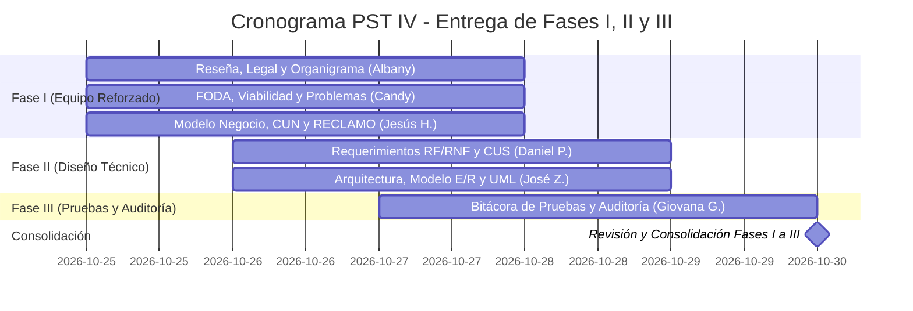

# 🚀 Plan de Trabajo y Cronograma — PST IV
### Actualización y Corrección Integral de Fases I, II y III
**Meta de la Semana:** Transformar el documento actual (heredado de PST III) en el informe real de **PST IV**, corrigiendo inconsistencias, eliminando menciones viejas a Excel/Superset y completando formalmente **hasta la Fase III inclusive** con base en el **Esquema Oficial PNFI 2018**.  
**Fecha Límite:** **Viernes 30 de Octubre de 2026**.  

---

## 👥 Asignación de Tareas por Fases y Habilidades

Para avanzar de forma organizada y sin cuellos de botella, las tareas se dividen entre los **6 integrantes** según su perfil: las partes analíticas/descriptivas van para el equipo de Fase I, y las partes técnicas para quienes dominan modelado e ingeniería.

---

### 🏛️ EQUIPO FASE I — Planificación, Diagnóstico y Modelo de Negocio
La Fase I documenta el contexto y el modelo correspondientes al período estudiado. Se conservará el contenido histórico aprobado y no se incorporarán retrospectivamente a esa sección las funciones actuales de NexoInt, Dory o Jarvis. Las correcciones se limitarán a errores comprobables; cualquier evolución posterior se explicará en la sección del proyecto que corresponda.

#### 👤 1. Jesús Hernández (Coordinación de Fase I, Metodología y Procesos)
* **Responsabilidad Principal:** Coordinar los diagramas y la metodología de calidad de la Fase I, respetando el alcance temporal del diagnóstico original.
* **Tareas a Ejecutar:**
  1. **Alcance del modelo de negocio:** No reescribir la descripción histórica de la Fase I ni sustituirla por la arquitectura o las funcionalidades posteriores de PST IV. Si se requiere explicar el funcionamiento actual, ubicarlo en la sección de evolución/solución propuesta y diferenciarlo del diagnóstico histórico.
  2. **Diagramas del Negocio:** Revisar el **Mapa de Procesos** y el **Diagrama de Casos de Uso del Negocio (CUN)** según el alcance y los actores descritos en la Fase I. No añadir a esos diagramas procesos o módulos posteriores sin aprobación expresa.
     - 📖 *¿Dónde consultar la información?* Ver [Sección 2.3 y 2.4 de pst-4-arquitectura.md](./pst-4-arquitectura.md#23-mapa-y-flujograma-de-procesos-de-negocio).
  3. **Metodología de Calidad RECLAMO:** Redactar la justificación y aplicación requerida para el proyecto, sin modificar hechos del diagnóstico original.
  4. **Reflexión Crítica de la Fase I:** mantenerla vinculada con el período y los resultados documentados en esa fase.
* **Plazo de Entrega:** **Miércoles 28 de Octubre - 06:00 PM**

#### 👤 2. Albany Reyes (Contexto Empresarial, Organigrama y Fundamentación Legal)
* **Responsabilidad Principal:** Revisar la presentación del contexto empresarial y actualizar el organigrama únicamente con información institucional confirmada.
* **Tareas a Ejecutar:**
  1. **Reseña histórica, misión y visión:** Conservar el contenido aprobado. Corregir solo errores formales o datos que el equipo confirme; no reescribir la historia empresarial sin nuevas fuentes.
  2. **Organigrama:** Preparar la actualización al año 2026 cuando se proporcionen nombres, cargos y relaciones jerárquicas validadas. No inferir puestos ni líneas de dependencia.
     - 📖 *¿Dónde consultar la información?* Ver [Sección 2.1 de pst-4-arquitectura.md](./pst-4-arquitectura.md#21-contexto-y-diagnóstico-situacional-participativo).
  3. **Fundamentación Legal:** Mantener la versión aprobada y revisar citas/redacción con fuentes; cambiar el contenido solo si se identifica una corrección necesaria.
     - Constitución de la República Bolivariana de Venezuela (Art. 110).
     - Ley de Infogobierno y Decreto N° 3.390 (Software Libre).
     - Plan de la Patria (Objetivos históricos de soberanía tecnológica).
     - Ley Orgánica de Ciencia, Tecnología e Innovación (LOCTI).
  4. **Corrección de forma:** Revisar ortografía y coherencia sin alterar hechos ni cambiar el sentido de las secciones aprobadas.
* **Plazo de Entrega:** **Miércoles 28 de Octubre - 06:00 PM**

#### 👤 3. Candy Gutiérrez (Diagnóstico Situacional, FODA y Árbol de Problemas)
* **Responsabilidad Principal:** Formulación analítica del problema, estudio de factibilidad y viabilidad operativa.
* **Guía de Correcciones Asignada:** 📖 Consultar [Auditoría y Correcciones Fase I - Candy Gutiérrez](./pst-4-auditoria-candy-fase-1.md) para el detalle de cambios requeridos en el Google Docs.
* **Tareas a Ejecutar y Corregir:**
  1. **Estudio de Factibilidad:** Completar las 4 dimensiones (Social, Económica, Técnica y Operativa) que actualmente están en blanco en el Google Docs.
  2. **Eliminación de términos contables/facturación:** Sustituir "facturación formal", "horas facturables" e "inexactitud contable" por "registro de tiempo consumido" y "auditoría operativa de casos" (conforme al alcance funcional delimitado para este trayecto).
  3. **Árbol del Problema y Tabla de Jerarquización:** Actualizar el problema central y causas según el modelo de PST IV 2026 (sin indicar que la empresa está "sin tecnología" ni usa "hojas de cálculo").
  4. **Matriz FODA:** Ajustar debilidades y oportunidades para enfocarlas en la fragmentación de canales y consolidación en NexoInt.
  5. **Diferenciación Dory / Jarvis:** Corregir en la Reflexión Crítica para identificar a Dory como el bot de Discord y a Jarvis como el agente de GitHub.
* **Plazo de Entrega:** **Miércoles 28 de Octubre - 06:00 PM**

---

### ⚙️ EQUIPO FASE II — Requerimientos y Diseño Técnico (Software)

#### 👤 4. Daniel Pérez (Especificación Técnica, Requerimientos y Casos de Uso)
* **Responsabilidad Principal:** Redactar la sección técnica de la Fase II con las fichas PNFI y los casos de uso sustentados en la arquitectura y la documentación técnica proporcionada para el proyecto.
* **Tareas a Ejecutar:**
  1. **Sección técnica del informe:** Documentar componentes, límites entre NexoInt web, Supabase, API de Dory/Discord y Jarvis; flujo de datos, permisos y dependencias, tomando como fuente las guías técnicas entregadas. No se le asigna revisar código ni acceder a repositorios privados; tampoco debe describir un backend/API Gateway propio como parte del sistema.
  2. **Documentación técnica de apoyo:** Usar primero la [Guía técnica de procesos PST IV](./pst-4-guia-tecnica-procesos.md), que describe los flujos de NexoInt, Dory/Jarvis, sincronización, reportes, permisos y estados de desarrollo. Complementar con [Arquitectura del PST IV](./pst-4-arquitectura.md) y el [índice de referencias técnicas del PST IV](./referencias-tecnicas/README.md), que organiza la API de conversaciones, releases, IA y NexoKube. Consultar también el [inventario conceptual de datos `dory`](../database/README.md), sin tomarlo como definición definitiva de columnas o políticas vigentes. Todo el material asignado está dentro de Control-PST y debe bastar para redactar esta sección; las dudas funcionales se consultan al equipo.
  3. **Requerimientos Funcionales (RF):** Completar las fichas oficiales del PNFI para:
     - `RF-01`: Autenticación y autorización por roles y permisos de ventana/acción en NexoInt.
     - `RF-02`: Apertura, clasificación y sincronización de tickets de clientes y solicitudes internas desde Discord, validando compañía y canal. La separación básica existe; la consolidación de campos, vistas, búsquedas y reportes forma parte del alcance de continuidad y sigue en desarrollo.
     - `RF-03`: Actualización y cierre de casos, asignación de consultor, estado de atención y registro del tiempo consumido. Documentar por separado la base operativa y los ajustes de flujo todavía en desarrollo.
     - `RF-04`: Seguimiento contextual de Dory y detección de intención de cierre, con confirmación humana cuando corresponda. La propuesta del mes incluye ampliar el análisis de contexto, conservar pendientes concretos y evitar seguimientos improcedentes; esas mejoras no deben declararse completas sin validación.
     - `RF-05`: Gestión de releases con Jarvis: evidencia de cambios entre versiones, enlaces relacionados y detección de XML aplicables. La trazabilidad heredada entre ZK, Swing, Patch y bibliotecas, la redacción sin duplicados y la recuperación de publicaciones se mantienen en desarrollo según la propuesta.
     - `RF-06` (**en desarrollo; no listo para declararse implementado**): Completar y validar el calendario de actividades, guardias, días festivos y cumpleaños visibles según permisos.
     - `RF-07`: Indicadores de soporte y actividad de consultores, incluyendo la distinción entre tickets e internas. La ampliación del panel mensual y los aportes de GitHub en repositorios configurados deben documentarse según su estado real, no como parte automáticamente terminada del panel.
     - `RF-08`: Reportes, filtros y exportación/impresión, conservando la selección y los enlaces a los casos. La propuesta mantiene en desarrollo la consistencia entre pantalla, CSV/XLS/XLSX y PDF, junto con la conservación de filtros.
     - `RF-09`: API de conversación de Dory para consultar mensajes y adjuntos de Discord sin duplicar transcripciones en la base de datos. La consulta base existe; completar y validar los elementos del alcance propuesto (autores, fechas, respuestas, reacciones, embeds, adjuntos y exportación).
     - `RF-10`: Administración de tokens de integración con alcance y revocación. La propuesta requiere completar permisos diferenciados de lectura, exportación y escritura y verificar la autorización en cada endpoint.
     - `RF-11`: Consola NexoKube para consultar clústeres, namespaces, pods, deployments/statefulsets, configuración, salud y logs; especificar edición de manifiestos/versiones, escala y reinicio como acciones protegidas por permisos de rol, y no marcarlas entregadas sin validación. La propuesta de octubre no constituye evidencia de aceptación de estas acciones.
     - `RF-12`: Acceso de compañías en desarrollo: grupos, compañías, usuarios externos, asignación de permisos y aislamiento de datos por organización.
     - `RF-13`: Aplicación móvil NexoInt, en desarrollo; especificar solo las funciones confirmadas por el equipo y no presentarla como entregada.
  4. **Requerimientos No Funcionales (RNF):** Especificar seguridad, privacidad por compañía, integridad de sincronización, manejo de errores, rendimiento, portabilidad y disponibilidad con criterios verificables. No atribuir certificaciones ni objetivos de SLA no acordados.
  5. **Casos de Uso del Software (CUS):** Elaborar actores, precondiciones, flujo principal, excepciones y resultados para apertura/sincronización de casos, actualización/cierre, consulta de conversación, seguimiento, releases, reportes y administración de accesos.
  6. **Trazabilidad de estado:** Contrastar cada requisito con la propuesta de continuidad de octubre de 2026 y separar (a) base funcional disponible, (b) ampliación propuesta en desarrollo y (c) capacidad pendiente de validar en despliegue. La propuesta expresa alcance y prioridad, no certifica que un entregable esté listo. No marcar como implementado el alcance completo solo porque exista una pantalla o una primera versión. Contratos/bolsas de horas, recibos/facturación y marcajes no forman parte de este alcance.
* **Plazo de Entrega:** **Jueves 29 de Octubre - 06:00 PM**

#### 👤 5. José Zúñiga (Ingeniería Técnica, Arquitectura y Modelo de Datos)
* **Responsabilidad Principal:** Diagramas UML, modelo relacional y diseño técnico.
* **Tareas a Ejecutar:**
  1. **Arquitectura del Software (3 Pilares):** Describir `nexoint`, `discord_bot`/`jarvis` y `NexoInt`.
     - 📖 *¿Dónde consultar la información?* Ver [Sección 3.1 y 3.2 de pst-4-arquitectura.md](./pst-4-arquitectura.md#31-visión-arquitectónica-general).
  2. **Modelo E/R y Diccionario de Datos:** Transcribir el modelo del esquema `dory` (PostgreSQL 16 en Supabase) y la tabla de entidades.
     - 📖 *¿Dónde consultar la información?* Ver [Diccionario de Datos en database/README.md](../database/README.md).
  3. **Diagramas de Ingeniería:** Diagrama de Componentes, Diagrama de Despliegue y Diagrama de Secuencia Global.
     - 📖 *¿Dónde consultar la información?* Ver [Sección 3.5 y 3.6 de pst-4-arquitectura.md](./pst-4-arquitectura.md#35-diagrama-de-interacción-y-flujo-de-datos-global).
  4. **Reflexión Crítica de la Fase II.**
* **Plazo de Entrega:** **Jueves 29 de Octubre - 06:00 PM**

---

### 🧪 EQUIPO FASE III — Implantación, Pruebas y Auditoría

#### 👤 6. Giovana Garrido (Pruebas del Sistema y Auditoría Informática)
* **Responsabilidad Principal:** Casos de prueba actualizados y reporte formal de auditoría.
* **Tareas a Ejecutar:**
  1. **Actualizar Casos de Prueba:** Corregir fechas y flujos obsoletos. Definir y ejecutar pruebas verificables para apertura/sincronización de casos, permisos, OAuth, llamadas a Dory, calendario y publicación de releases; registrar resultados reales, sin asumir que existe una suite automatizada.
  2. **Pruebas de Integración y Rendimiento:** Medir escenarios acordados y documentar resultados observados. No prometer latencias (< 250 ms), concurrencia o disponibilidad hasta tener mediciones y criterios aprobados.
  3. **Informe de Resultados de Auditoría Informática (Exigido en Trayecto IV):**
     - Análisis de vulnerabilidades SAST y DAST.
     - Auditoría de control de accesos (tokens JWT, RBAC dinámico por ventanas).
     - Revisar políticas de respaldo y recuperación configuradas por los servicios; consignar RPO/RTO únicamente si están definidos y comprobados.
     - 📖 *¿Dónde consultar la información?* Ver [Sección 4 de pst-4-arquitectura.md](./pst-4-arquitectura.md#4-fase-iii-estrategias-de-implantación-pruebas-y-auditoría-informática).
  4. **Reflexión Crítica de la Fase III.**
* **Plazo de Entrega:** **Viernes 30 de Octubre - 12:00 PM (Mediodía)**

---

## 📅 Cronograma de Entrega (Semana al Viernes 30 de Octubre)

| Día | Meta del Día |
| :--- | :--- |
| **Lunes 26 / Martes 27** | Arranque de la reescritura de Fase I (Albany, Candy y Jesús H.) y vaciado de requerimientos (Daniel P.). |
| **Miércoles 28 (06:00 PM)** | **HITO 1: FASE I COMPLETA Y REVISADA.** Se entrega modelo de negocio nuevo, organigrama 2026, FODA, legal y CUN. |
| **Jueves 29 (06:00 PM)** | **HITO 2: FASE II COMPLETA.** Se entregan los requerimientos de Daniel P. y toda la ingeniería de José Z. (Modelo E/R y diagramas UML). |
| **Viernes 30 (12:00 PM)** | **HITO 3: FASE III COMPLETA.** Se entregan las pruebas 2026 y el Informe de Auditoría Informática de Giovana G. Documento consolidado hasta Fase III listo para revisión docente. |

---

> [!TIP]
> **Nota de Ayuda para el Equipo:**  
> Si algún compañero tiene dudas sobre qué escribir en su sección, todo el material técnico, diagramas e información de la empresa ya están listos en el repositorio en [docs/proyectos/pst-4-arquitectura.md](./pst-4-arquitectura.md) y en [docs/database/README.md](../database/README.md). Solo deben leer los enlaces indicados arriba y adaptarlos al documento de Google Docs.
