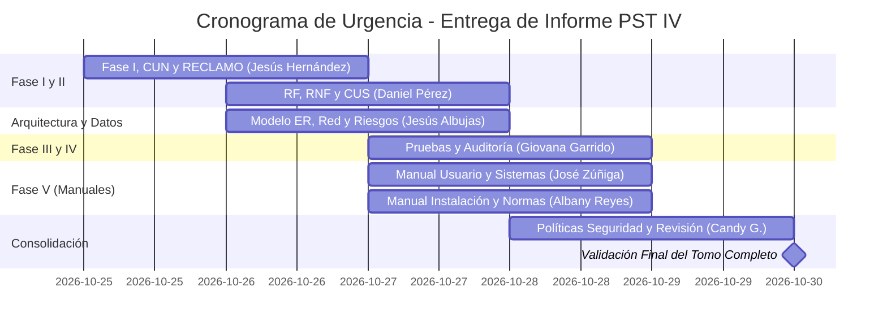

# 🚀 Plan de Trabajo y Cronograma de Urgencia — PST IV
### Actualización y Corrección Integral del Informe de Proyecto de Grado
**Meta:** Transformar el documento actual (heredado de PST III) en el informe real de **PST IV**, corrigiendo inconsistencias, redactando los componentes faltantes y completando las 5 Fases exigidas por el **Esquema Oficial PNFI 2018**.  
**Fecha Límite Improrrogable:** **Viernes 30 de Octubre de 2026** (5 días de ejecución).  
**Equipo Responsable (7 Integrantes):**  
1. **Jesús Albujas** (Líder Técnico / Arquitectura & Datos)  
2. **Jesús Hernández** (Coordinador de Redacción & Metodología)  
3. **Daniel Pérez**  
4. **José Zúñiga**  
5. **Giovana Garrido**  
6. **Albany Reyes**  
7. **Candy Gutiérrez**  

---

## ⚠️ Diagnóstico Crítico: ¿Qué debe cambiarse obligatoriamente?

El documento actual en Google Docs tiene **dos problemas graves**:
1. **Contenido Obsoleto de PST III:** Habla de Apache Superset, registro en hojas de Excel y tiene fechas de Diciembre de 2025.
2. **El Proyecto Real de PST IV es otro:** Es el **Ecosistema Digital de 3 Pilares**:
   - **`nexoint`**: Core Backend, API Gateway, Supabase (PostgreSQL 16 en esquema `dory`), autenticación federada (Google y Discord OAuth), seguridad bancaria NIST/OWASP y roles RBAC dinámicos por ventanas.
   - **`discord_bot` & `jarvis`**: Bot conversacional en Discord.js v14 (`/abrir_hilo`, `/cerrar_hilo`, `/asignar_consultor`), orquestador de IA `jarvis` para Release Notes automáticos, monitor de SLAs en horario Caracas (UTC-4) y soporte a tickets internos (`is_internal_request`).
   - **`la app`**: Portal cliente web y móvil para consulta de bolsas de horas y Kanban de consultores.

---

## 👥 Asignación Nominal de Tareas por Integrante

Cada integrante es responsable directo de su bloque en el Google Doc y tiene fuentes de apoyo directas en el repositorio local [`/opt/development/github/control-pst`](file:///opt/development/github/control-pst):

### 👤 1. Jesús Hernández (Coordinación, Fase I y Metodología)
* **Objetivo:** Dejar la **Fase I** 100% pulida y adaptar la metodología en **Fase II**.
* **Tareas Específicas a Ejecutar:**
  1. **Actualizar el Organigrama y Reseña de ERP Consultores:** Asegurar que refleje el año 2026 y la estructura operativa real.
  2. **Reemplazar el Modelo de Negocio:** Eliminar menciones viejas a Superset y redactar el nuevo flujo (Discord $\leftrightarrow$ NexoInt $\leftrightarrow$ Base de Datos $\leftrightarrow$ Clientes).
  3. **Incorporar Diagrama CUN y Mapa de Procesos:** Transcribir los diagramas ya generados en [`docs/proyectos/pst-4-arquitectura.md`](file:///opt/development/github/control-pst/docs/proyectos/pst-4-arquitectura.md#23-mapa-y-flujograma-de-procesos-de-negocio).
  4. **Metodología de Calidad RECLAMO (Fase II):** Redactar la sección obligatoria de RECLAMO que actualmente no existe en el documento.
  5. **Reflexiones Críticas:** Redactar la Reflexión Crítica de Fase I y Fase II.
* **Plazo de Entrega:** **Martes 27 de Octubre - 06:00 PM**

---

### 👤 2. Daniel Pérez (Fase II — Requerimientos y Casos de Uso del Software)
* **Objetivo:** Tabular los Requerimientos Funcionales y No Funcionales y redactar los Casos de Uso CUS.
* **Tareas Específicas a Ejecutar:**
  1. **Llenar las Fichas de Requerimientos Funcionales (RF):** Usar la plantilla oficial (Código, Nombre, Descripción, Entradas, Salidas, Prioridad):
     - `RF-01`: Autenticación federada (Google / Discord OAuth).
     - `RF-02`: Creación de tickets en Discord (`/abrir_hilo`).
     - `RF-03`: Cierre operativo e imputación de horas (`/cerrar_hilo`).
     - `RF-04`: Asignación de consultores (`/asignar_consultor`).
     - `RF-05`: Generación de Release Notes con IA (`jarvis`).
     - `RF-06`: Control de bolsas de horas y contratos en NexoInt.
  2. **Fichas de Requerimientos No Funcionales (RNF):** Plantillas de Seguridad (NIST/OWASP), Disponibilidad (24/7), Rendimiento (latencia < 250ms) y Portabilidad (Web/Docker).
  3. **Especificación de Casos de Uso (CUS):** Redactar las plantillas detalladas de casos de uso (Precondiciones, Flujo Principal, Flujos Alternos y Postcondiciones).
* **Plazo de Entrega:** **Miércoles 28 de Octubre - 06:00 PM**

---

### 👤 3. Jesús Albujas (Fase II y IV — Arquitectura, Base de Datos y Red)
* **Objetivo:** Proveer los diagramas de ingeniería definitivos, el modelo de datos y la topología de red.
* **Tareas Específicas a Ejecutar:**
  1. **Modelo E/R y Diccionario de Datos (Fase II):** Pegar el diagrama Entidad-Relación oficial del esquema `dory` y la tabla descriptiva de entidades de [`docs/database/README.md`](file:///opt/development/github/control-pst/docs/database/README.md).
  2. **Diagramas UML (Fase II):** Diagrama de Componentes, Diagrama de Despliegue y Diagrama de Secuencia global.
  3. **Diagrama Físico y Lógico de Red (Fase IV - Punto 2):** Completar la sección que está en blanco con la topología de servidores (Cloud VPS, Docker Bridge `172.20.0.0/16`, Nginx SSL, Discord Gateway).
  4. **Matriz Integral de Riesgos (Fase IV - Punto 3):** Tabular la matriz completa de riesgos (tecnológicos, operativos, legales, financieros) con sus planes de mitigación.
* **Plazo de Entrega:** **Miércoles 28 de Octubre - 06:00 PM**

---

### 👤 4. Giovana Garrido (Fase III — Pruebas de Software y Auditoría Informática)
* **Objetivo:** Actualizar la bitácora de pruebas eliminando las fechas de 2025 y redactar el Informe de Auditoría.
* **Tareas Específicas a Ejecutar:**
  1. **Actualizar Casos de Prueba:** Corregir las fechas de 2025 al presente (2026) y agregar casos de prueba reales para `nexoint` y `/cerrar_hilo`.
  2. **Pruebas de Carga e Integración:** Documentar pruebas simuladas con `k6`/`Locust` de concurrencia y tiempos de respuesta.
  3. **Redactar el Informe de Auditoría Informática (Exigido en Trayecto IV):**
     - Técnicas de auditoría aplicadas: Análisis estático (SAST) y dinámico (DAST).
     - Auditoría de seguridad: Revisión de tokens JWT, control de accesos RBAC y sanitización de inputs.
     - Plan de Continuidad y Respaldos: RPO < 2 horas, RTO < 30 minutos con `pg_dump` cifrado.
  4. **Reflexión Crítica de la Fase III.**
* **Plazo de Entrega:** **Jueves 29 de Octubre - 06:00 PM**

---

### 👤 5. José Zúñiga (Fase V — Manual de Usuario y Manual de Sistemas)
* **Objetivo:** Redactar dos de los manuales técnicos obligatorios.
* **Tareas Específicas a Ejecutar:**
  1. **Manual de Usuario:**
     - Guía paso a paso ilustrada para el Cliente: Cómo abrir un hilo en Discord, cómo interactuar con el soporte y cómo consultar sus horas en `la app`.
     - Guía para el Consultor: Cómo usar `/cerrar_hilo`, `/actualizar_hilo` y `/asignar_consultor`.
  2. **Manual de Sistemas:**
     - Arquitectura técnica del sistema.
     - Documentación de APIs y Endpoints (rutas de autenticación, tickets, webhooks de Jarvis).
     - Diccionario de tablas principales del esquema `dory`.
* **Plazo de Entrega:** **Jueves 29 de Octubre - 06:00 PM**

---

### 👤 6. Albany Reyes (Fase V — Manual de Instalación y Manual de Normas)
* **Objetivo:** Redactar la guía de despliegue y las normas operativas.
* **Tareas Específicas a Ejecutar:**
  1. **Manual de Instalación:**
     - Requisitos de hardware y software (Linux, Docker 24+, Docker Compose, Node.js).
     - Paso a paso de clonación de repositorio, configuración del archivo `.env` y ejecución de `docker compose up -d`.
     - Procedimiento de inicialización de la base de datos en Supabase.
  2. **Manual de Normas y Procedimientos:**
     - Procedimiento operativo para la apertura de tickets de clientes.
     - Protocolo de escalamiento de incidencias (L1 y L2) y tiempos de atención según SLAs.
     - Procedimiento administrativo para el cierre de mes y facturación de bolsas de horas.
* **Plazo de Entrega:** **Jueves 29 de Octubre - 06:00 PM**

---

### 👤 7. Candy Gutiérrez (Fase V — Políticas de Seguridad y Revisión Final)
* **Objetivo:** Redactar las políticas de seguridad informática y realizar la corrección ortotipográfica y de normas de todo el informe.
* **Tareas Específicas a Ejecutar:**
  1. **Políticas y Estándares de Seguridad Informática:**
     - *Seguridad Física:* Control de acceso a terminales, servidores y puestos de trabajo.
     - *Seguridad Lógica:* Política de contraseñas seguras, autenticación OAuth/2FA, expiración de sesiones (NIST 800-63B) y gestión de roles RBAC.
     - *Política de Respaldo y Recuperación:* Frecuencia de backups, almacenamiento seguro y pruebas de restauración periódicas.
  2. **Revisión General de Estilo y Normas UPTEP / APA:**
     - Homogeneizar tipografía, márgenes, numeración de cuadros e imágenes.
     - Actualizar el Índice General, Índice de Cuadros e Índice de Gráficos.
     - Revisar y completar la bibliografía en formato APA.
* **Plazo de Entrega:** **Viernes 30 de Octubre - 12:00 PM (Mediodía)**

---

## 📅 Cronograma de Ejecución Diario (Día a Día)

| Día | Hito / Meta del Día |
| :--- | :--- |
| **Domingo 25 / Lunes 26** | Socialización del plan en el grupo. Asignación formal y arranque de redacción. |
| **Martes 27** | **Hito 1:** Entrega de Fase I corregida y CUN (Jesús H.). Avance al 70% de Requerimientos y Manuales. |
| **Miércoles 28** | **Hito 2:** Cierre de Fase II (Requerimientos, Diagramas, Arquitectura y Modelo E/R de BD). |
| **Jueves 29** | **Hito 3:** Cierre de Fase III (Pruebas y Auditoría) y entrega de los primeros 4 Manuales. |
| **Viernes 30 (12:00 PM)** | **Hito 4:** Políticas de Seguridad listas, unificación del documento, revisión de índices y entrega del tomo completo listo para revisión docente. |

---

## 🛠️ Reglas de Oro para el Equipo

1. **Cero Menciones a Sistemas Viejos:** Queda terminantemente prohibido mencionar que los datos se pasan a mano a Excel o que Superset es el sistema principal. El sistema es **NexoInt**, **Discord Bot (con Jarvis)** y **La App**.
2. **Uso de Insumos Listos:** Antes de redactar cualquier diagrama o tabla, consulten la documentación técnica en el repositorio [`/opt/development/github/control-pst`](file:///opt/development/github/control-pst). Casi todos los diagramas y explicaciones técnicas ya están hechos; solo deben transcribirlos y darles formato académico.
3. **Control en Google Docs:** Cada quien trabaja en su sección sin borrar texto de otros. Cualquier duda técnica, consultar con **Jesús Albujas** o **Jesús Hernández**.
