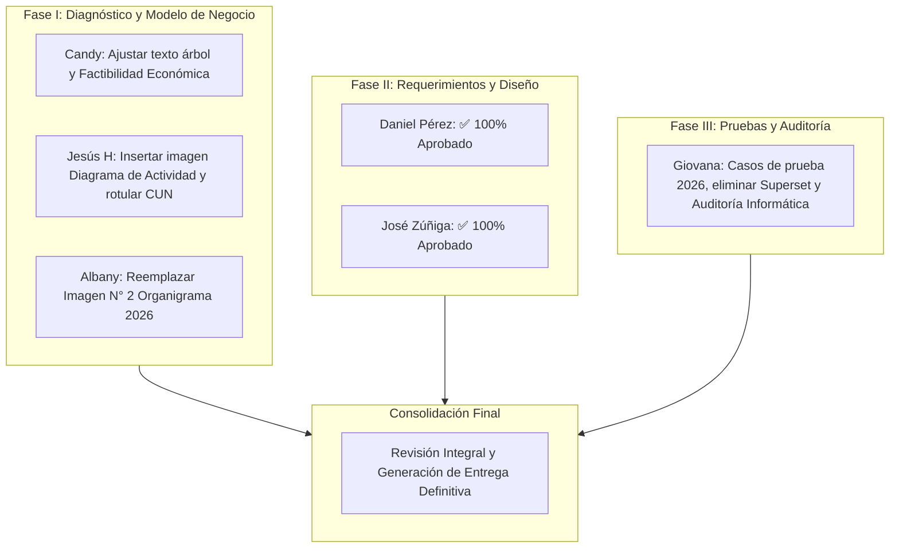

# 🚀 Plan de Trabajo, Cronograma y Calendario de Ejecución — PST IV
### Actualización y Corrección Integral de Fases I, II y III (Normativa PNFI 2018)
**Meta General:** Transformar el documento heredado de PST III en el informe formal de **PST IV**, corrigiendo inconsistencias, eliminando menciones desfasadas (Excel, Superset, cobros/facturación) y completando formalmente **hasta la Fase III inclusive**.  
**Fecha de Actualización y Auditoría:** **Lunes 02 de Noviembre de 2026**.  

---

## 📈 Tablero de Avance Global del Proyecto

```text
[████████████████░░░░] 78% Avance Global del Documento (Fases I, II y III)

Fase I   (Diagnóstico y Negocio):  [████████████████░░░░] 85%  (Detalles en Organigrama, Actividad y Factibilidad)
Fase II  (Ingeniería y Software):  [████████████████████] 100% (¡Aprobada y Cerrada al 100%!)
Fase III (Pruebas y Auditoría):    [░░░░░░░░░░░░░░░░░░░░]  5%  (Guía lista en repo, pendiente vaciado)
```

---

## 📅 Calendario Semanal de Ejecución y Registro de Cumplimiento
**Semana Objetivo:** Lunes 02 de Noviembre al Viernes 06 de Noviembre de 2026.

| Día | Integrante | Tarea / Entrega Asignada | Estado | Verificación / Comprobación |
| :--- | :--- | :--- | :---: | :--- |
| **Lunes 02/11** | **Daniel Pérez** | Vaciado y rotulado formal de 4 Diagramas de Casos de Uso (`Imágenes N° 10, 11, 12 y 13`). | ✅ **CUMPLIDO** | Verificado en Google Docs. Títulos formales y fuente `(2026)`. Fase II de Daniel cerrada al 100%. |
| **Lunes 02/11** | **José Zúñiga** | Vaciado íntegro de arquitectura, 18 tablas de diccionario, UML y reflexión Fase II. | ✅ **CUMPLIDO** | Verificado en Google Docs. Esquema `dory` completo, fuentes `(2026)`. Fase II de José cerrada al 100%. |
| **Lunes 02/11** | **Candy Gutiérrez** | Matriz FODA (Cuadro 15), Problema N° 2 (Cuadro 16) y nueva Reflexión Crítica Fase I. | ✅ **CUMPLIDO** | Verificado en Google Docs. Aprobado 10/10 sin términos contables ni Excel. |
| **Lunes 02/11** | **Jesús Hernández** | Redacción de 4 tablas CUN (Cuadros 11 al 14) y montaje del Diagrama CUN. | ✅ **CUMPLIDO** | Verificado en Google Docs. Tablas de negocio llenas y CUN montado en P[231]. |
| **Lunes 02/11** | **Albany Reyes** | Notificación de corrección de Organigrama Estructural 2026. | 🔄 **EN PROCESO** | Respuesta recibida ("no había podido"). Estructura formal de 3 ramas enviada para montaje. |
| **Lunes 02/11** | **Giovana Garrido** | Entrega de guía técnica de Fase III con plantilla de pruebas y auditoría. | ✅ **CUMPLIDO** | Documento guía publicado en el repositorio (`pst-4-auditoria-giovana-fase-3.md`). |
| **Martes 03/11** | **Albany Reyes** | Montar la nueva imagen del Organigrama 2026 (Imagen N° 2) con las 3 ramas independientes. | ⏳ **PENDIENTE** | Subir imagen con: Dirección General (Carlos y Botero), Funcional (Silviana), Técnica (Jesús A.) y Proyectos (Waditza y José U.). |
| **Martes 03/11** | **Jesús Hernández** | Insertar imagen del Diagrama de Actividad (Párrafo 248) y rotular formalmente CUN. | ⏳ **PENDIENTE** | Pegar imagen de actividad; agregar `Imagen N° 7...` y cambiar año de fuentes a `(2026)` en Cuadros 11 al 14. |
| **Martes 03/11** | **Candy Gutiérrez** | Ajustar 2 palabras en Factibilidad Económica y texto previo al Árbol de Problemas. | ⏳ **PENDIENTE** | Cambiar "facturación" por "gestión operativa" y ajustar P[273] según la guía. |
| **Miércoles 04/11**| **Giovana Garrido** | Eliminar Apache Superset del documento y vaciar stack tecnológico 2026 de PST IV. | ⏳ **PENDIENTE** | Vaciado de frameworks (NestJS, React/Vite, Supabase, Discord.js, GitHub Octokit) en P[658-690]. |
| **Miércoles 04/11**| **Giovana Garrido** | Vaciado de Casos de Prueba CP-01 al CP-04 (Discord, Dory, NexoInt Web). | ⏳ **PENDIENTE** | Completar tablas de pruebas funcionales 2026 según especificación del repo. |
| **Jueves 05/11** | **Giovana Garrido** | Vaciado de Casos de Prueba CP-05 y CP-06 + Informe de Auditoría Informática. | ⏳ **PENDIENTE** | Documentar SAST, DAST, RBAC en NexoInt y auditoría de tablas `dory_changelog`. |
| **Jueves 05/11** | **Giovana Garrido** | Redactar Reflexión Crítica de Fase III con enfoque de cierre de Trayecto IV. | ⏳ **PENDIENTE** | Reflexión formal sin fechas de 2025 ni menciones a Superset. |
| **Viernes 06/11** | **Equipo Completo** | Control de calidad integral, verificación de numeración cruzada y entrega final. | ⏳ **PENDIENTE** | Comprobación de que todas las tablas y figuras tengan año 2026 y generar PDF definitivo. |

---

## 📊 Tablero Resumen de Estado y Entregas por Integrante

| Integrante | Fase / Responsabilidad | Estado | % Avance | ✅ Listo y Verificado | ⏳ Pendiente por Hacer / Corregir |
| :--- | :--- | :---: | :---: | :--- | :--- |
| **José Zúñiga** | **Fase II:** Arquitectura, BD y UML | **✅ 100% COMPLETADO** | **100%** | • Arquitectura de 3 pilares (`Imagen N° 14`).<br>• Modelo de Clases (`Imagen N° 15`) y Secuencia (`Imagen N° 16`).<br>• Modelo Relacional E/R (`Imagen N° 17`) y **18 tablas de Diccionario de Datos** (Cuadros N° 20 al 37).<br>• Navegación y Carta Estructurada (`Imágenes N° 18 y 19`).<br>• Componentes y Despliegue (`Imágenes N° 20 y 21`).<br>• Reflexión Crítica de Fase II. | *Ninguno (Sección 100% aprobada).* |
| **Daniel Pérez** | **Fase II:** Requerimientos y CUS | **✅ 100% COMPLETADO** | **100%** | • 13 Requerimientos Funcionales (`RF-01` al `RF-13`).<br>• 15 Requerimientos No Funcionales (`RNF-01` al `RNF-15`).<br>• Fichas técnicas CUS completas.<br>• **4 diagramas de Casos de Uso separados y rotulados** (`Imágenes N° 10, 11, 12 y 13`). | *Ninguno (Sección 100% aprobada).* |
| **Candy Gutiérrez** | **Fase I:** Diagnóstico, FODA y Problemas | **🔄 AVANCE AVANZADO** | **90%** | • **Matriz FODA (Cuadro N° 15): Aprobada 10/10** (sin Excel ni facturación).<br>• **Problema N° 2 (Cuadro N° 16): Corregido y Aprobado**.<br>• **Reflexión Crítica Fase I: Rehecha y Aprobada**.<br>• **Estudio de Factibilidad:** Redactado en las 4 dimensiones. | • Actualizar texto descriptivo del Árbol del Problema (Párrafo 273).<br>• Ajustar 2 frases de "facturación" en Factibilidad Económica (Párrafos 106-107). |
| **Jesús Hernández** | **Fase I:** Modelo de Negocio y Diagramas | **🔄 AVANCE AVANZADO** | **85%** | • **4 Tablas CUN (`CU-01` al `CU-04`)** llenas con flujos y reglas.<br>• Imagen del Diagrama CUN insertada (Párrafo 231).<br>• Metodología RECLAMO redactada. | • **Insertar imagen del Diagrama de Actividad** (Párrafos 248 a 251 en blanco).<br>• Rotular imagen del CUN (`Imagen N° 7... Fuente: (2026)`).<br>• Cambiar año de fuentes a (2026) en Cuadros 11 al 14. |
| **Albany Reyes** | **Fase I:** Organigrama y Fundamentación | **⏳ PENDIENTE CRÍTICO** | **80%** | • Reseña histórica, Misión, Visión y Fundamentación Legal completas. | • **Reemplazar Imagen N° 2 del Organigrama 2026** por el diseño con las 3 ramas independientes (Funcional, Técnica de Jesús Albujas, y Proyectos con Waditza y José Uzcátegui). |
| **Giovana Garrido** | **Fase III:** Pruebas y Auditoría | **⏳ PENDIENTE COMPLETO** | **10%** | • Guía detallada y plantillas técnicas estructuradas en el repositorio. | • Actualizar casos de prueba a 2026 (NexoInt, Discord, Jarvis, Supabase).<br>• Eliminar menciones a Superset y fechas de 2025.<br>• Incorporar Informe de Auditoría Informática (SAST/DAST y RBAC).<br>• Actualizar Reflexión Crítica de Fase III. |

---

## 👥 Detalle Individual y Mensajes para Cada Integrante

---

### 🏛️ EQUIPO FASE I — Planificación, Diagnóstico y Modelo de Negocio

---

#### 👤 1. Jesús Hernández (Coordinación de Fase I, Metodología y Procesos)

> **Estado:** **🔄 EN AVANCE AVANZADO (02/11/2026)**  
> **Guía Asignada:** 📖 Consultar [Auditoría y Guía de Tareas - Jesús Hernández](./pst-4-auditoria-jesus-h-fase-1.md)  
> **✅ Verificado y Listo:**
> - [x] **Plantillas CUN (Cuadros N° 11 al 14 / Tablas 6 a 9):** Vaciadas y completadas con éxito (`CU-01 Registrar caso`, `CU-02 Gestionar caso`, `CU-03 Generar reporte`, `CU-04 Recibir reportes`).
> - [x] **Diagrama CUN:** Imagen incorporada en el Párrafo 231.
> - [x] **Metodología de Calidad RECLAMO:** Redactada en la sección correspondiente.

> [!NOTE]
> **⏳ Tareas pendientes por corregir (Jesús Hernández):**  
> 1. **Falta la Imagen del Diagrama de Actividad:** El título está en el Párrafo 248, pero entre P[249] y P[252] no hay imagen (el espacio quedó en blanco).  
> 2. **Rotulado de la Imagen del CUN:** Agregar arriba `Imagen N° 7: Diagrama de Casos de Uso del Negocio (CUN)` y abajo `Fuente: Hernández H. Jesús A. (2026)`.  
> 3. **Actualizar Año en Cuadros 11 al 14:** Las fuentes de las plantillas CUN dicen *(2025)*; deben actualizarse a *(2026)*. En el Cuadro 11 corregir el título (*Plantilla de especificación de Registrar caso*).

> 💬 **Mensaje para copiar y enviar a Jesús Hernández:**  
> *"Epa Jesús, revisé tu sección del Modelo de Negocio: las 4 tablas de Casos de Uso del Negocio (Cuadros 11 al 14) quedaron muy bien llenas y la imagen del CUN ya está montada en el documento. Solo te faltan dos detalles mínimos para cerrar tu parte: 1) Montar la imagen del Diagrama de Actividad en el párrafo 248 que quedó en blanco, y 2) Ponerle a la imagen del CUN su título formal arriba y fuente abajo (Imagen N° 7: Diagrama CUN / Fuente: Hernández H. Jesús A. 2026), y cambiar a 2026 las fuentes de los cuadros 11 al 14."*

<details>
<summary><b>📂 Ver Detalle Técnico de Tareas de Jesús Hernández</b></summary>
<br>

* **Responsabilidad Principal:** Coordinar la estructuración del Modelo de Negocio (Sección III) y la metodología de calidad RECLAMO.
* **Guía de Apoyo:** Ver [Sección 2 de pst-4-arquitectura.md](./pst-4-arquitectura.md#2-fase-i-planificación-diagnóstico-y-modelo-de-negocio).
* **Flujograma para el Diagrama de Actividad:**
  - Cliente reporta en Discord ➔ Bot Dory abre hilo y exige Tópico/Tipología ➔ Consultor atiende y ejecuta `/cerrar_hilo` con tiempo consumido ➔ Supabase almacena caso y tiempos ➔ NexoInt despliega métricas a gerencia.

</details>

---

#### 👤 2. Albany Reyes (Contexto Empresarial, Organigrama y Fundamentación Legal)

> **Estado:** **⏳ PENDIENTE CRÍTICO DE CORRECCIÓN (02/11/2026)**  
> **Guía Asignada:** 📖 Consultar [Auditoría y Guía de Tareas - Albany Reyes](./pst-4-auditoria-albany-fase-1.md) y [Guía de Organigrama 2026](./pst-4-organigrama-guia.md)  
> **✅ Verificado y Listo:**
> - [x] **Reseña Histórica, Misión y Visión:** Redactadas y aprobadas.
> - [x] **Fundamentación Legal:** Citas de CRBV Art. 110, Ley de Infogobierno, Decreto 3.390, Plan de la Patria y LOCTI completas.

> [!WARNING]
> **⏳ Tarea Crítica Pendiente (Albany Reyes):**  
> **Reemplazar la Imagen N° 2 del Organigrama:** La imagen actual sigue teniendo fecha vieja *(2025)* y un error de jerarquía donde todos están como analistas funcionales y Waditza depende de Jesús Albujas.  
> 
> *Estructura 2026 que debe montar en la imagen:*
> - **Dirección General:** Carlos Parada y José Botero (Socios Directores).
> - **Rama 1 (Consultoría Funcional):** Silviana (Senior) ➔ Nahomy y Daniel.
> - **Rama 2 (Ingeniería e Integraciones):** Jesús Albujas (independiente).
> - **Rama 3 (Gestión de Proyectos):** Waditza (Líder de Proyectos) ➔ José Uzcátegui (Analista de Proyectos).
> - **Pie de figura:** `Imagen N° 2: Organigrama Estructural... Fuente: Reyes S. Albany A. (2026).`

> 💬 **Mensaje para copiar y enviar a Albany Reyes:**  
> *"Hola Albany, lo de la reseña y leyes está listo y aprobado. Lo único que nos falta de tu parte es actualizar la imagen del organigrama (Imagen N° 2 en el doc), que todavía tiene la versión vieja de 2025. Recuerda que arriba van Carlos Parada y José Botero, y de ahí salen 3 ramas separadas: 1) Silviana con Nahomy y Daniel, 2) Jesús Albujas en Ingeniería aparte, y 3) Waditza en Proyectos con José Uzcátegui. En el repositorio dejé el diagrama exacto para que lo copies idéntico."*

---

#### 👤 3. Candy Gutiérrez (Diagnóstico Situacional, FODA y Árbol de Problemas)

> **Estado:** **🔄 EN AVANCE AVANZADO (02/11/2026)**  
> **Guía Asignada:** 📖 Consultar [Auditoría y Correcciones Fase I - Candy Gutiérrez](./pst-4-auditoria-candy-fase-1.md)  
> **✅ Verificado y Listo:**
> - [x] **Matriz FODA (Cuadro N° 15 / Tabla 10): APROBADA (10/10)**, sin menciones a Excel ni facturación, alineada a Discord/NexoInt/Supabase/Jarvis.
> - [x] **Tabla de Jerarquización de Problemas (Cuadro N° 16 / Tabla 11): APROBADA**. El Problema N° 2 quedó corregido como: *"Dificultad para auditar y consolidar los tiempos operativos invertidos por el personal técnico en la atención de casos"*.
> - [x] **Reflexión Crítica de Fase I (Párrafo 283): APROBADA**. Texto nuevo formal sin términos contables ni hojas de cálculo.
> - [x] **Estudio de Factibilidad:** Redactadas las 4 dimensiones (Social, Económica, Técnica y Operativa).

> [!NOTE]
> **⏳ Tareas pendientes por pulir (Candy Gutiérrez):**  
> 1. **Texto del Árbol del Problema (Párrafo 273):** Cambiar la frase que dice *"la problemática central de la empresa (la gestión manual)..."* por *"la fragmentación en el seguimiento administrativo y carencia de una consola web centralizada"*.  
> 2. **Factibilidad Económica (Párrafos 106-107):** Reemplazar las dos frases de *"procesos administrativos y de facturación"* y *"horas que anteriormente quedaban sin registrar o facturar"* por *"procesos de auditoría operativa"* y *"horas que anteriormente quedaban sin trazabilidad formal"*.

> 💬 **Mensaje para copiar y enviar a Candy Gutiérrez:**  
> *"Hola Candy, excelente trabajo con la Reflexión Crítica y la corrección del Problema 2 en la tabla, quedaron aprobados. Ya solo te faltan dos detalles mínimos para cerrar tu parte: 1) En el párrafo 273 (antes del árbol), cambia la frase que dice 'la gestión manual' por 'la fragmentación en el seguimiento administrativo y carencia de una consola web centralizada', y 2) En la Factibilidad Económica (párrafos 106 y 107), cambia dos palabras donde dice 'facturación' por 'auditoría operativa y registro de tiempos'."*

---

### ⚙️ EQUIPO FASE II — Requerimientos y Diseño Técnico (Software)

---

#### 👤 4. Daniel Pérez (Especificación Técnica, Requerimientos y Casos de Uso)

> **Estado:** **✅ 100% COMPLETADO Y APROBADO (02/11/2026)**  
> **✅ Verificado y Listo:**
> - [x] **13 Requerimientos Funcionales (`RF-01` al `RF-13`):** Vaciados bajo plantilla formal PNFI (Entradas, Procesos, Salidas, Actores).
> - [x] **15 Requerimientos No Funcionales (`RNF-01` al `RNF-15`):** Criterios de verificación medibles de seguridad, aislamiento y rendimiento.
> - [x] **Fichas Técnicas de Casos de Uso (CUS):** Flujos principales, alternos y reglas de negocio.
> - [x] **4 Diagramas de Casos de Uso debidamente separados y titulados:**  
>   - `Imagen N° 10: Gestión de soporte y seguimiento de casos` (Fuente: Pérez Daniel, 2026).  
>   - `Imagen N° 11: Integración con Discord y API de Dory` (Fuente: Pérez Daniel, 2026).  
>   - `Imagen N° 12: Asistencia contextual de Dory` (Fuente: Pérez Daniel, 2026).  
>   - `Imagen N° 13: Jarvis, Informes y NexoKube` (Fuente: Pérez Daniel, 2026).

> 💬 **Mensaje para copiar y enviar a Daniel Pérez:**  
> *"Daniel, revisé tus cambios en el documento: los 4 diagramas de casos de uso quedaron perfectos, separados y con sus títulos formales (Imágenes 10 a 13) con tu fuente 2026. Toda tu sección de requerimientos y casos de uso de la Fase II está 100% aprobada."*

---

#### 👤 5. José Zúñiga (Ingeniería Técnica, Arquitectura y Modelo de Datos)

> **Estado:** **✅ 100% COMPLETADO Y APROBADO (02/11/2026)**  
> **✅ Verificado y Listo:**
> - [x] **Visión Arquitectónica General:** Detallados los 3 pilares (`NexoInt Web`, `discord_bot / Dory / Jarvis`, `Supabase Cloud esquema dory`) y delimitación de módulos en desarrollo (`Imagen N° 14`).
> - [x] **Modelo de Clases y Objetos:** 4 paquetes lógicos documentados con la `Imagen N° 15: Diagrama de Clases y Dominio`.
> - [x] **Comportamiento Dinámico:** Flujo transaccional con la `Imagen N° 16: Diagrama de Secuencia Global`.
> - [x] **Modelo de Datos Relacional:** `Imagen N° 17: Modelo Entidad-Relación (Esquema dory)`.
> - [x] **Diccionario de Datos Exhaustivo:** 18 tablas detalladas (Cuadros N° 20 al 37: `dory_client`, `dory_channel`, `dory_thread`, `dory_message`, `dory_changelog`, etc.).
> - [x] **Mapa de Navegación y Carta Estructurada:** `Imagen N° 18` (Navegación Web) e `Imagen N° 19` (Carta Estructurada).
> - [x] **Interfaz de Usuario y Formularios:** Vistas web y comandos slash en Discord.
> - [x] **Diagrama de Componentes y Despliegue:** `Imagen N° 20: Diagrama de Componentes` e `Imagen N° 21: Diagrama de Despliegue`.
> - [x] **Reflexión Crítica de la Fase II:** Redactada con enfoque formal de Trayecto IV.  
*(Todas las figuras y tablas debidamente rotuladas con Fuente: Zúñiga S. José D. 2026).*

> 💬 **Mensaje para copiar y enviar a José Zúñiga:**  
> *"José, revisé toda tu parte de la Fase II en el documento y quedó impecable, un trabajo de ingeniería 20/20. Toda la arquitectura de 3 pilares, diagramas UML (clases, secuencia, componentes, despliegue), las 18 tablas de diccionario de datos del esquema dory y la reflexión crítica están completas y aprobadas al 100%."*

---

### 🧪 EQUIPO FASE III — Implantación, Pruebas y Auditoría

---

#### 👤 6. Giovana Garrido (Pruebas del Sistema y Auditoría Informática)

> **Estado:** **⏳ PENDIENTE COMPLETO DE ACTUALIZACIÓN (02/11/2026)**  
> **Guía Asignada:** 📖 Consultar [Auditoría y Guía de Tareas - Giovana Garrido (Fase III)](./pst-4-auditoria-giovana-fase-3.md)  
> **Diagnóstico del Documento:** La Fase III (Párrafos 658 al 750) conserva el texto viejo de diciembre de 2025 que menciona Apache Superset y pruebas viejas de PST III.

> [!WARNING]
> **⏳ Tareas Requeridas para Giovana Garrido:**  
> 1. **Actualizar Casos de Prueba a 2026:** Eliminar menciones a Apache Superset y fechas de 2025. Incorporar pruebas de:
>    - Creación de caso por Discord (`/abrir_hilo`).
>    - Cierre de caso con tiempo consumido (`/cerrar_hilo`).
>    - Visualización de indicadores y reportes en `NexoInt Web` (sustituye a Superset).
>    - Releases con Jarvis en GitHub.
> 2. **Estrategias de Implantación:** Documentar el despliegue del ecosistema (Frontend React/Vite en Nginx, demonio `discord_bot` en Node.js, y Supabase Cloud con RLS).
> 3. **Informe de Resultados de Auditoría Informática (Exigido en Trayecto IV):**
>    - Auditoría de autenticación y tokens JWT (Supabase Auth).
>    - Control de acceso dinámico por roles (RBAC) en NexoInt.
>    - Análisis SAST/DAST (prevención de SQLi y protección de variables `.env`).
>    - Auditabilidad en `dory_changelog`.
> 4. **Actualizar Reflexión Crítica de Fase III:** Eliminar las fechas de 2025 y las menciones a Superset, enfocándola en los resultados de pruebas y auditoría 2026.

> 💬 **Mensaje para copiar y enviar a Giovana Garrido:**  
> *"Giovana, cuando puedas entra al documento para actualizar la Fase III. Actualmente tiene el texto del año pasado que menciona diciembre de 2025 y Apache Superset (recuerda que Superset se eliminó y ahora usamos NexoInt). En el repositorio te dejé la guía completa en docs/proyectos/pst-4-auditoria-giovana-fase-3.md con los 4 casos de prueba nuevos que debes colocar y el esquema del Informe de Auditoría Informática que pide la universidad."*

---

## 📅 Cronograma y Ruta Crítica de Cierre


