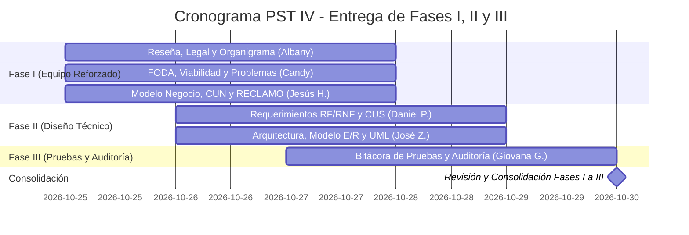

# 🚀 Plan de Trabajo y Cronograma — PST IV
### Actualización y Corrección Integral de Fases I, II y III
**Meta de la Semana:** Transformar el documento actual (heredado de PST III) en el informe real de **PST IV**, corrigiendo inconsistencias, eliminando menciones viejas a Excel/Superset y completando formalmente **hasta la Fase III inclusive** con base en el **Esquema Oficial PNFI 2018**.  
**Fecha Límite:** **Viernes 30 de Octubre de 2026**.  

---

## 👥 Asignación de Tareas por Fases y Habilidades

Para avanzar de forma organizada y sin cuellos de botella, las tareas se dividen entre los **6 integrantes** según su perfil: las partes analíticas/descriptivas van para el equipo de Fase I, y las partes técnicas para quienes dominan modelado e ingeniería.

---

### 🏛️ EQUIPO FASE I — Planificación, Diagnóstico y Modelo de Negocio
La Fase I documenta el contexto y el modelo correspondientes al período estudiado. Se conservará el contenido histórico aprobado y no se incorporarán retrospectivamente a esa sección las funciones actuales de NexoInt, Dory o Jarvis. Las correcciones se limitarán a errores comprobables; cualquier evolución posterior se explicará en la sección del proyecto que corresponda.

#### 👤 1. Jesús Hernández (Coordinación de Fase I, Metodología y Procesos)

> **Estado:** **🔄 AVANCES VERIFICADOS (30/10/2026)**  
> **Resultado de la Revisión:** Vaciadas y completadas con éxito las 4 plantillas de Casos de Uso del Negocio (Cuadros N° 11 al 14: `CU-01 Registrar caso`, `CU-02 Gestionar caso`, `CU-03 Generar reporte`, `CU-04 Recibir reportes`) e insertada la imagen del Diagrama CUN. La metodología de calidad RECLAMO está incorporada.

> [!NOTE]
> **Detalles pendientes por pulir (Jesús Hernández):**  
> 1. **Falta la Imagen del Diagrama de Actividad:** El título y párrafo descriptivo están en el documento (Párrafos 248-249), pero falta insertar el gráfico de actividad del negocio (Párrafos 250-251).  
> 2. **Rotulado de la Imagen del CUN:** Agregar número formal arriba y fuente abajo (`Imagen N° X: Diagrama de Casos de Uso del Negocio` / `Fuente: Hernández H. Jesús A. (2026)`).  
> 3. **Actualizar Año en Cuadros 11 al 14:** Las fuentes de las plantillas CUN dicen *(2025)*; deben actualizarse a *(2026)*. En el Cuadro 11 corregir el título (*Plantilla de especificación de Registrar caso*).

<details>
<summary><b>📂 Ver Detalle de Tareas de Jesús Hernández (Click para desplegar)</b></summary>
<br>

* **Responsabilidad Principal:** Coordinar la estructuración del Modelo de Negocio (Sección III) y la metodología de calidad RECLAMO, trabajando en conjunto con Albany Reyes.
* **Guía de Apoyo Metodológico:** 📖 Consultar [Guía de Fase I (Diagnóstico, Factibilidad y FODA)](./pst-4-fase-1-guia-metodologica.md) y [Sección 2 de pst-4-arquitectura.md](./pst-4-arquitectura.md#2-fase-i-planificación-diagnóstico-y-modelo-de-negocio).
* **Detalle de Tareas Ejecutadas y Pendientes:**
  1. **Plantillas CUN (Cuadros N° 11 al 14):** ✅ Vaciadas en Tablas 6 a 9 con flujos principales, alternos y reglas del negocio (RN-01 a RN-04).
  2. **Diagrama CUN:** ✅ Imagen insertada en Párrafo 231. (Pendiente rotular número y fuente 2026).
  3. **Diagrama de Actividad:** ⏳ Pendiente insertar la imagen del flujo en Párrafo 250.
  4. **Metodología de Calidad RECLAMO:** ✅ Redactada en la sección correspondiente.
  5. **Reflexión Crítica de la Fase I:** Mantenerla enfocada en la necesidad de integración y auditoría de soporte de 2026 (sin mencionar cobros ni planillas manuales).

</details>

---

#### 👤 2. Albany Reyes (Contexto Empresarial, Organigrama y Apoyo en Modelo de Negocio)

> **Estado:** **🔄 EN CORRECCIÓN / REASIGNADA A APOYO DIRECTO DE JESÚS HERNÁNDEZ**  
> **Guía de Correcciones y Tareas Asignada:** 📖 Consultar [Auditoría y Guía de Tareas - Albany Reyes](./pst-4-auditoria-albany-fase-1.md) para el detalle de la jerarquía empresarial y las plantillas a completar en el Google Docs.  
> **Responsabilidad Principal:** Corregir el organigrama estructural 2026 de la empresa y **apoyar activamente a Jesús Hernández en la redacción y vaciado de las tablas y diagramas del Modelo de Negocio (Sección III)**.

> [!WARNING]
> **Detalle Crítico en el Organigrama Actual (Imagen N° 2 en Google Docs):**  
> El organigrama que subió tiene errores graves de jerarquía: agrupó a todo el personal en un solo bloque genérico de "analistas funcionales", incluyó a Jesús Albujas bajo esa área y subordinó a Waditza bajo Jesús.  
> 
> *Estructura Real 2026 que debe graficar:*
> - **Dirección General (Cabecera):** Carlos Parada y José Botero (Socios Directores).
> - **Área Funcional y Soporte:** Silviana (Senior) -> Nahomy y Daniel.
> - **Área de Ingeniería/Integraciones (Rama directa de Carlos Parada):** Jesús Albujas (independiente).
> - **Área de Proyectos (Rama directa de Dirección):** Waditza (Líder de Proyectos) -> José Uzcátegui (Analista de Proyectos).
> - 📖 Ver diagrama de referencia exacto en: [Guía de Organigrama Estructural 2026](./pst-4-organigrama-guia.md).

<details>
<summary><b>📂 Ver Tareas y Asignación de Apoyo para Albany Reyes (Click para desplegar)</b></summary>
<br>

* **Tareas a Ejecutar:**
  1. **Corregir Imagen N° 2 (Organigrama):** Reemplazar la imagen actual en el Google Docs por el organigrama con las 3 ramas independientes (Funcional, Técnica y Proyectos con José Uzcátegui).
  2. **Vaciado y Redacción Conjunta con Jesús Hernández (Sección III - Modelo de Negocio):**  
     Al estar el contexto histórico y la fundamentación legal ya redactados, Albany debe apoyar a Jesús Hernández en el vaciado de los elementos que están en blanco:
     - Completar las **Plantillas de Especificación de Casos de Uso del Negocio (Cuadros N° 11, 12, 13 y 14)** que actualmente están vacías.
     - Diseñar e insertar el **Diagrama de Casos de Uso del Negocio (CUN)** y los **Diagramas de Actividad** faltantes.
  3. **Revisión de Coherencia:** Verificar que en toda la Fase I se sustituyan los términos viejos de "facturación de horas" por "registro de tiempo operativo".
* **Plazo de Entrega:** **Miércoles 28 de Octubre - 10:00 PM**

</details>

---

#### 👤 3. Candy Gutiérrez (Diagnóstico Situacional, FODA y Árbol de Problemas)

> **Estado:** **🔄 MATRIZ FODA Y FACTIBILIDAD COMPLETADAS (30/10/2026)**  
> **Resultado de la Revisión:**  
> - **✅ Matriz FODA (Cuadro N° 15 / Tabla 10): APROBADA (10/10).** Candy rehízo la matriz completamente alineada a PST IV: cero menciones a "hojas de cálculo" ni "facturación", enfoque en Discord ↔ NexoInt ↔ Supabase, supervisión humana de IA (Jarvis) y delimitación de componentes en desarrollo.
> - **✅ Estudio de Factibilidad (Líneas 99 a 119):** Desarrolladas las 4 dimensiones (Social, Económica, Técnica y Operativa).

> [!IMPORTANT]
> **Tareas Inmediatas para Candy Gutiérrez (Pasos finales para cerrar su entrega):**  
> 1. **Tabla de Jerarquización de Problemas (Cuadro N° 16 / Tabla 11):** En el Problema N° 2, sustituir *"transcripción manual hacia hojas de cálculo para la contabilidad de horas facturables"* por *"Dificultad para auditar, fiscalizar y consolidar los tiempos operativos invertidos por el personal técnico en la atención de casos"*.  
> 2. **Árbol del Problema (Párrafos 272-277 / Imagen N° 20):** Actualizar el texto y la imagen para no decir que la empresa está *"sin tecnología y con planillas de cálculo"*. Colocar el problema central: *Fragmentación en el seguimiento administrativo y carencia de una consola web centralizada...*  
> 3. **Reflexión Crítica de Fase I (Párrafo 282):** Actualizar el párrafo para eliminar las menciones heredadas de PST III a "hojas de cálculo" y "facturación".  
> 4. **Ajuste Menor en Factibilidad Económica (Párrafos 106-107):** Reemplazar las dos frases que dicen "facturación" por "auditoría operativa y registro de tiempos".  
> 📖 Consultar el detalle exacto de redacción en [Auditoría y Correcciones Fase I - Candy Gutiérrez](./pst-4-auditoria-candy-fase-1.md).

<details>
<summary><b>📂 Ver Detalle de Tareas de Candy Gutiérrez (Click para desplegar)</b></summary>
<br>

* **Responsabilidad Principal:** Formulación analítica del problema, estudio de factibilidad y viabilidad operativa.
* **Detalle de Estado:**
  1. **Matriz FODA:** ✅ Completada y Aprobada formalmente.
  2. **Estudio de Factibilidad:** ✅ Redactado (Pendiente ajuste menor de dos términos en económica).
  3. **Tabla de Jerarquización:** ⏳ Pendiente actualizar Problema N° 2.
  4. **Árbol del Problema:** ⏳ Pendiente actualizar texto e Imagen N° 20.
  5. **Reflexión Crítica de la Fase I:** ⏳ Pendiente actualizar redacción sin términos contables/hojas de cálculo.

</details>

---

### ⚙️ EQUIPO FASE II — Requerimientos y Diseño Técnico (Software)

#### 👤 4. Daniel Pérez (Especificación Técnica, Requerimientos y Casos de Uso)

> **Estado:** **✅ COMPLETADO Y VERIFICADO (28/10/2026)**  
> **Resultado de la Revisión:** Vaciado íntegro de los 13 Requerimientos Funcionales (`RF-01` a `RF-13`), 15 Requerimientos No Funcionales (`RNF-01` a `RNF-15`) y fichas de Casos de Uso del Software (CUS) bajo la plantilla formal PNFI. Cumplimiento estricto del alcance (cero menciones a cobros/facturación) y correcta delimitación de componentes (`Dory`, `Jarvis`, `NexoInt`).

> [!NOTE]
> **Detalle pendiente por pulir (Formato de Imágenes):**  
> En la sección de Diagramas de Casos de Uso, se insertaron 4 imágenes continuas que solo tienen *"Fuente: Pérez Daniel (2026)"*. Debe agregarse a cada una su número e identificación descriptiva arriba de la imagen.  
> 
> *Ejemplo de cómo debe quedar:*
> ```text
> Imagen N° 10: Diagrama de Casos de Uso General del Sistema
> [Imagen del Diagrama]
> Fuente: Pérez Daniel (2026).
> 
> Imagen N° 11: Diagrama de Casos de Uso - Gestión de Soporte y Casos (Dory)
> [Imagen del Diagrama]
> Fuente: Pérez Daniel (2026).
> ```

<details>
<summary><b>📂 Ver Detalle de Tareas Ejecutadas por Daniel Pérez (Click para desplegar)</b></summary>
<br>

* **Responsabilidad Principal:** Redactar la sección técnica de la Fase II con las fichas PNFI y los casos de uso sustentados en la arquitectura y la documentación técnica proporcionada para el proyecto.
* **Detalle de Contenido Vaciado:**
  1. **Sección técnica del informe:** Documentación de componentes, límites entre NexoInt web, Supabase, API de Dory/Discord y Jarvis; flujo de datos, permisos y dependencias.
  2. **Requerimientos Funcionales (RF):** Completadas las 13 fichas oficiales del PNFI (`RF-01` a `RF-13`):
     - `RF-01`: Autenticación y autorización por roles y permisos de ventana/acción en NexoInt.
     - `RF-02`: Apertura, clasificación y sincronización de tickets de clientes y solicitudes internas desde Discord.
     - `RF-03`: Actualización y cierre de casos, asignación de consultor, estado de atención y registro del tiempo consumido.
     - `RF-04`: Seguimiento contextual de Dory y detección de intención de cierre.
     - `RF-05`: Gestión de releases con Jarvis y evidencia técnica de versiones.
     - `RF-06`: Calendario de actividades y guardias.
     - `RF-07`: Indicadores de soporte y actividad de consultores.
     - `RF-08`: Reportes, filtros y exportación/impresión.
     - `RF-09`: API de conversación de Dory para consulta de mensajes y adjuntos.
     - `RF-10`: Administración de tokens de integración con alcance y revocación.
     - `RF-11`: Consola NexoKube para consulta y estado de clústeres.
     - `RF-12`: Acceso de compañías (alcance en desarrollo claramente delimitado).
     - `RF-13`: Aplicación móvil NexoInt (alcance en desarrollo claramente delimitado).
  3. **Requerimientos No Funcionales (RNF):** Fichas `RNF-01` a `RNF-15` con criterios de verificación medibles (seguridad, aislamiento por compañía, integridad, supervisión de IA, etc.).
  4. **Casos de Uso del Software (CUS):** Especificaciones de flujos de eventos principales, excepciones y postcondiciones.

</details>

---

#### 👤 5. José Zúñiga (Ingeniería Técnica, Arquitectura y Modelo de Datos)
* **Responsabilidad Principal:** Diagramas UML, modelo relacional y diseño técnico.
* **Tareas a Ejecutar:**
  1. **Arquitectura del Software (3 Pilares):** Describir `nexoint`, `discord_bot`/`jarvis` y `NexoInt`.
     - 📖 *¿Dónde consultar la información?* Ver [Sección 3.1 y 3.2 de pst-4-arquitectura.md](./pst-4-arquitectura.md#31-visión-arquitectónica-general).
  2. **Modelo E/R y Diccionario de Datos:** Transcribir el modelo del esquema `dory` (PostgreSQL 16 en Supabase) y la tabla de entidades.
     - 📖 *¿Dónde consultar la información?* Ver [Diccionario de Datos en database/README.md](../database/README.md).
  3. **Diagramas de Ingeniería:** Diagrama de Componentes, Diagrama de Despliegue y Diagrama de Secuencia Global.
     - 📖 *¿Dónde consultar la información?* Ver [Sección 3.5 y 3.6 de pst-4-arquitectura.md](./pst-4-arquitectura.md#35-diagrama-de-interacción-y-flujo-de-datos-global).
  4. **Reflexión Crítica de la Fase II.**
* **Plazo de Entrega:** **Jueves 29 de Octubre - 06:00 PM**

---

### 🧪 EQUIPO FASE III — Implantación, Pruebas y Auditoría

#### 👤 6. Giovana Garrido (Pruebas del Sistema y Auditoría Informática)
* **Responsabilidad Principal:** Casos de prueba actualizados y reporte formal de auditoría.
* **Tareas a Ejecutar:**
  1. **Actualizar Casos de Prueba:** Corregir fechas y flujos obsoletos. Definir y ejecutar pruebas verificables para apertura/sincronización de casos, permisos, OAuth, llamadas a Dory, calendario y publicación de releases; registrar resultados reales, sin asumir que existe una suite automatizada.
  2. **Pruebas de Integración y Rendimiento:** Medir escenarios acordados y documentar resultados observados. No prometer latencias (< 250 ms), concurrencia o disponibilidad hasta tener mediciones y criterios aprobados.
  3. **Informe de Resultados de Auditoría Informática (Exigido en Trayecto IV):**
     - Análisis de vulnerabilidades SAST y DAST.
     - Auditoría de control de accesos (tokens JWT, RBAC dinámico por ventanas).
     - Revisar políticas de respaldo y recuperación configuradas por los servicios; consignar RPO/RTO únicamente si están definidos y comprobados.
     - 📖 *¿Dónde consultar la información?* Ver [Sección 4 de pst-4-arquitectura.md](./pst-4-arquitectura.md#4-fase-iii-estrategias-de-implantación-pruebas-y-auditoría-informática).
  4. **Reflexión Crítica de la Fase III.**
* **Plazo de Entrega:** **Viernes 30 de Octubre - 12:00 PM (Mediodía)**

---

## 📅 Cronograma de Entrega (Semana al Viernes 30 de Octubre)



| Día | Meta del Día |
| :--- | :--- |
| **Lunes 26 / Martes 27** | Arranque de la reescritura de Fase I (Albany, Candy y Jesús H.) y vaciado de requerimientos (Daniel P.). |
| **Miércoles 28 (06:00 PM)** | **HITO 1: FASE I COMPLETA Y REVISADA.** Se entrega modelo de negocio nuevo, organigrama 2026, FODA, legal y CUN. |
| **Jueves 29 (06:00 PM)** | **HITO 2: FASE II COMPLETA.** Se entregan los requerimientos de Daniel P. y toda la ingeniería de José Z. (Modelo E/R y diagramas UML). |
| **Viernes 30 (12:00 PM)** | **HITO 3: FASE III COMPLETA.** Se entregan las pruebas 2026 y el Informe de Auditoría Informática de Giovana G. Documento consolidado hasta Fase III listo para revisión docente. |

---

> [!TIP]
> **Nota de Ayuda para el Equipo:**  
> Si algún compañero tiene dudas sobre qué escribir en su sección, todo el material técnico, diagramas e información de la empresa ya están listos en el repositorio en [docs/proyectos/pst-4-arquitectura.md](./pst-4-arquitectura.md) y en [docs/database/README.md](../database/README.md). Solo deben leer los enlaces indicados arriba y adaptarlos al documento de Google Docs.
